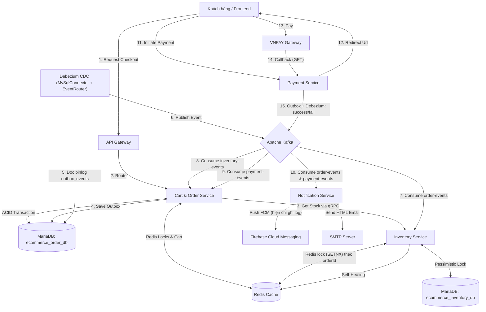
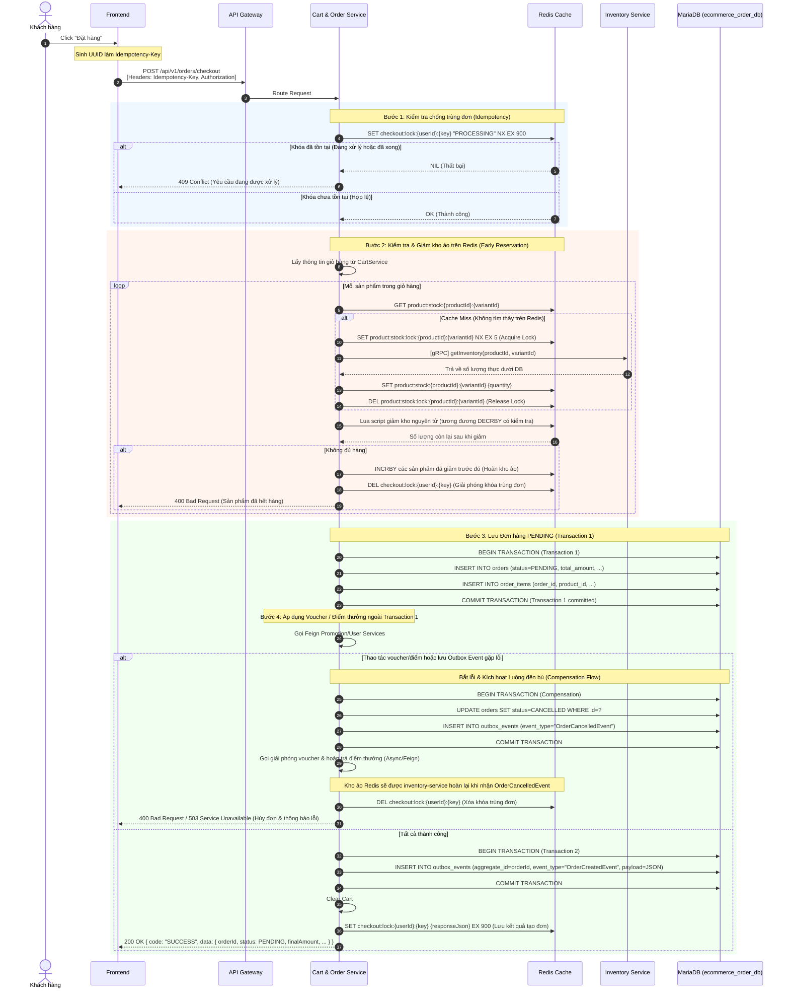
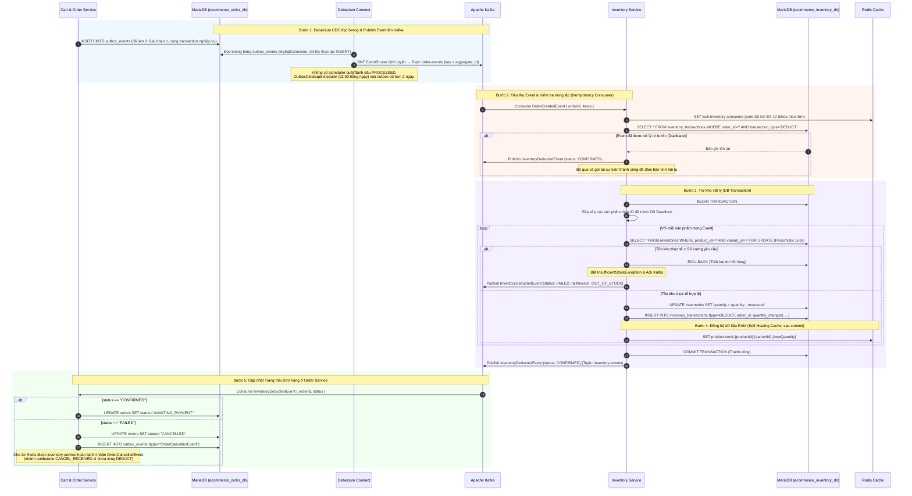
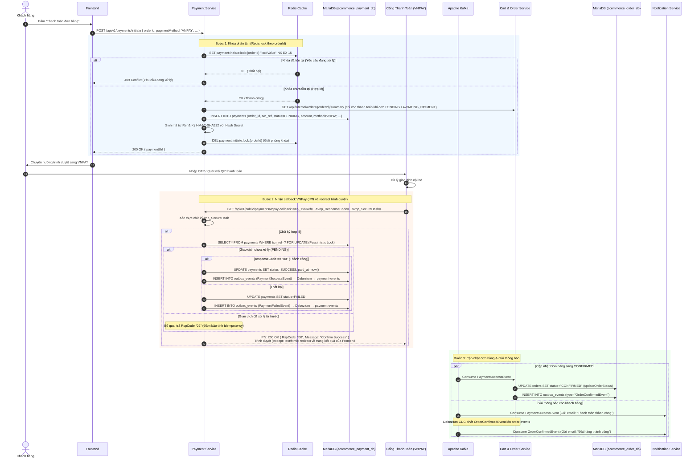
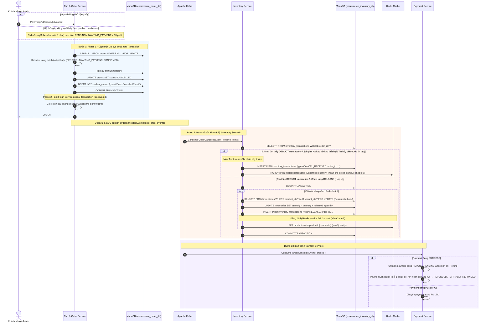

# 📋 TÀI LIỆU THIẾT KẾ: SƠ ĐỒ LUỒNG ĐẶT HÀNG CHI TIẾT (END-TO-END)
## Hệ thống E-Commerce Microservices

Tài liệu này đặc tả chi tiết luồng nghiệp vụ đặt hàng (Checkout & Order Lifecycle) của hệ thống, bao gồm sự tương tác giữa các dịch vụ: **API Gateway, Cart & Order Service, Promotion Service, Inventory Service, Payment Service, Notification Service**, cùng với hạ tầng **Kafka, Debezium (CDC), Redis, MariaDB 10.11** và **MongoDB** (lưu lịch sử thông báo của Notification Service).

> **Rà soát 2026-10-11:** Tài liệu đã được đối chiếu lại với code. Các điểm chính: Outbox được phát lên Kafka bằng **Debezium CDC** (`MySqlConnector` + SMT `EventRouter` đọc binlog bảng `outbox_events`), không có scheduler quét outbox; CSDL là **MariaDB 10.11**; trạng thái thanh toán thành công là `SUCCESS`; callback VNPay là `GET /api/v1/public/payments/vnpay-callback`; đơn quá hạn bị hủy sau **30 phút** (`OrderExpiryScheduler`); Push FCM hiện **chỉ ghi log** (chưa gửi thật).

---

## I. TỔNG QUAN KIẾN TRÚC LUỒNG ĐẶT HÀNG

Hệ thống sử dụng mô hình kết hợp giữa **Đồng bộ (Synchronous - REST/gRPC API)** cho các thao tác trực tiếp của người dùng và **Bất đồng bộ (Asynchronous - Event-Driven via Kafka & Transactional Outbox Pattern + Debezium CDC)** cho các tác vụ xử lý nền, đảm bảo tính nhất quán dữ liệu (Eventual Consistency), hiệu năng cao (High Throughput) và khả năng chịu tải tốt.

**Vòng đời trạng thái đơn hàng** (chỉ đi tiến, không quay lui — `updateOrderStatus` chặn chuyển về trạng thái có thứ hạng thấp hơn):
`PENDING` → `AWAITING_PAYMENT` → `CONFIRMED` → `SHIPPED` → `DELIVERED`, hoặc `CANCELLED` (hủy được khi đơn đang `PENDING` / `AWAITING_PAYMENT` / `CONFIRMED`).



---

## II. CHI TIẾT CÁC GIAI ĐOẠN XỬ LÝ (SEQUENCES)

Luồng đặt hàng từ khi người dùng click "Đặt hàng" cho đến khi nhận hàng được chia làm 5 giai đoạn chính:

### Giai đoạn 1: Khởi tạo Đơn hàng & Giữ chỗ kho tạm thời (Checkout & Early Reservation)
*   **Mục tiêu**: Nhận request từ người dùng, chống gửi trùng đơn (Idempotency), kiểm tra tồn kho nhanh trên RAM (Redis) để chặn sớm request hết hàng, tự động tải kho từ database qua gRPC nếu Redis bị cache miss, và lưu đơn hàng tạm thời ở trạng thái `PENDING`.



---

### Giai đoạn 2: Gửi Event & Trừ kho vật lý (Async Inventory Deduction & State Transition)
*   **Mục tiêu**: Đảm bảo sự kiện tạo đơn được gửi thành công đến Kafka (Transactional Outbox Pattern + Debezium CDC), Inventory Service thực hiện trừ kho vật lý an toàn dưới DB bằng cơ chế Pessimistic Lock (SELECT FOR UPDATE) kết hợp sắp xếp danh sách sản phẩm để tránh deadlock, và chuyển trạng thái đơn hàng sang `AWAITING_PAYMENT`.



---

### Giai đoạn 3: Thanh toán Đơn hàng (Payment Integration Flow)
*   **Mục tiêu**: Khách hàng thanh toán qua cổng thanh toán VNPAY (hoặc chọn COD). Payment Service tiếp nhận kết quả qua callback VNPay (IPN và redirect trình duyệt dùng chung một endpoint `GET`), xác thực chữ ký HMAC, và phát sự kiện thanh toán qua Outbox + Debezium. Order Service nhận sự kiện để cập nhật trạng thái đơn sang `CONFIRMED`.
*   Chỉ hỗ trợ **VNPAY** và **COD** (không có MoMo/Stripe). Với COD, Payment Service lưu payment `PENDING` và phát `PaymentCODConfirmedEvent` → Order Service chuyển đơn sang `CONFIRMED`; payment COD chuyển `SUCCESS` khi nhận `OrderDeliveredEvent` (Giai đoạn 5).



---

### Giai đoạn 4: Hủy đơn hàng và Hoàn trả kho / Hoàn tiền (Cancellation & Rollback Flow)
*   **Mục tiêu**: Xử lý hoàn trả tồn kho vật lý, kho ảo và hoàn tiền (nếu đã thanh toán) khi khách hàng yêu cầu hủy đơn, hoặc khi đơn hàng bị quá hạn thanh toán (`OrderExpiryScheduler` chạy mỗi 5 phút, hủy đơn `PENDING` / `AWAITING_PAYMENT` tạo quá **30 phút**). Ngoài ra, payment VNPAY `PENDING` quá hạn (mặc định 15 phút, `PAYMENT_EXPIRY_MINUTES`) được đối soát bằng VNPay QueryDR trước khi đánh dấu `EXPIRED`.



---

### Giai đoạn 5: Giao hàng và Hoàn tất đơn hàng (Shipping & Delivery Flow)
*   **Mục tiêu**: Người vận hành duyệt đơn hàng để chuyển vận chuyển, cập nhật trạng thái giao hàng thông qua webhook hành trình của đơn vị vận chuyển (ĐVVC) hoặc thao tác thủ công của Admin/Staff, và kết thúc vòng đời đơn hàng.
*   **Lưu ý**: Vận chuyển hiện là **mock** — không gọi API GHTK thật; mã vận đơn dạng `MOCK-GHTK-XXXXXXXX`, phí ship cố định 30.000đ.

```mermaid
sequenceDiagram
    autonumber
    actor Admin as Admin / Staff
    participant OS as Cart & Order Service
    participant DB as MariaDB (ecommerce_order_db)
    participant ĐVVC as Đơn vị Vận Chuyển (Mock GHTK)
    participant Kafka as Apache Kafka
    participant PS as Payment Service
    participant NS as Notification Service

    Admin->>OS: PUT /api/v1/orders/{id}/ship (Yêu cầu giao hàng)
    
    rect rgb(240, 248, 255)
        Note over OS, DB: Bước 1: Duyệt trạng thái sang SHIPPED & sinh mã vận đơn
        OS->>DB: SELECT ... FROM orders WHERE id=? FOR UPDATE
        OS->>OS: Kiểm tra: Trạng thái hiện tại bắt buộc phải là "CONFIRMED"
        OS->>OS: Sinh mã vận đơn mock "MOCK-GHTK-XXXXXXXX"
        OS->>DB: UPDATE orders SET status="SHIPPED", tracking_code="MOCK-GHTK-XXXXXXXX"
        OS->>DB: INSERT INTO outbox_events (type="OrderShippedEvent")
    end
    OS-->>Admin: 200 OK { status: SHIPPED, trackingCode }

    rect rgb(255, 245, 238)
        Note over ĐVVC, OS: Bước 2: Cập nhật hành trình (webhook ĐVVC hoặc Admin thao tác tay)
        alt Webhook từ ĐVVC
            ĐVVC->>OS: POST /api/v1/public/orders/shipping-webhook { trackingCode, status }<br/>[Header X-Shipping-Signature = HMAC-SHA256(secret, trackingCode|status)]
        else Admin / Staff
            Admin->>OS: PUT /api/v1/orders/{id}/delivery-status?status=DELIVERED
        end
        alt status == "SHIPPED"
            OS->>DB: Bỏ qua nếu đã là SHIPPED
        else status == "DELIVERED" (Giao hàng thành công)
            OS->>DB: UPDATE orders SET status="DELIVERED"
            OS->>DB: INSERT INTO outbox_events (type="OrderDeliveredEvent")
        end
        OS-->>ĐVVC: 200 OK
    end

    rect rgb(245, 240, 255)
        Note over Kafka, NS: Bước 3: Debezium CDC phát sự kiện → cập nhật COD & gửi Email
        Kafka->>PS: Consume OrderDeliveredEvent (payment COD đang PENDING → SUCCESS)
        Kafka->>NS: Consume OrderShippedEvent / OrderDeliveredEvent
        NS->>NS: Gửi Email HTML (SMTP) báo cho khách hàng; Push FCM hiện chỉ ghi log
    end
```

---

## III. ĐẶC TẢ CHI TIẾT CÁC CƠ CHẾ AN TOÀN & HIỆU NĂNG

> [!IMPORTANT]
> **1. Chống trùng lặp (Idempotency) & Đồng bộ ở các tầng:**
> *   **Tầng API Checkout**: Sử dụng Header `Idempotency-Key` (UUID sinh từ Client) lưu vào Redis dưới dạng `checkout:lock:{userId}:{key}` trong 15 phút. Nếu double-submit, request thứ hai bị từ chối ngay lập tức hoặc nhận về kết quả cũ đã được cache lại.
> *   **Tầng Khởi tạo Thanh toán**: Áp dụng **Redis Distributed Lock** với key `payment:initiate:lock:{orderId}` trong 15 giây. Khi chạy đa pod (Horizontal Scaling), cơ chế này chặn tuyệt đối việc 2 request gửi đồng thời tới 2 pod khác nhau tạo ra 2 đường link thanh toán và 2 bản ghi Payment trùng lặp cho cùng một Order.
> *   **Tầng Callback VNPay (IPN)**: Sử dụng **Pessimistic Lock (`FOR UPDATE`)** trong database khi truy vấn thông tin thanh toán (`findByTxnRefWithLock`). Nếu VNPay gọi IPN đồng thời hoặc khách hàng redirect trình duyệt cùng lúc, giao dịch sẽ được khóa và xử lý tuần tự, kiểm tra trạng thái khác `PENDING` để bỏ qua.
>     *   *Tránh trùng lặp / Race Condition Redirect*: Nếu IPN callback từ VNPay xử lý xong trước và cập nhật trạng thái thanh toán thành `SUCCESS`, trình duyệt redirect của khách hàng đến sau sẽ nhận mã phản hồi `"02"` (Đã thanh toán). Hệ thống tự động phát hiện và ghi đè hiển thị mã `"00"` trên trình duyệt để tránh việc khách hàng bị báo lỗi giả gây hoang mang.
> *   **Tầng Hoàn tiền (Auto-Refund)**: Kiểm tra sự tồn tại của bản ghi hoàn tiền bằng `existsByPaymentId` trước khi lưu để chặn trùng lặp khi Kafka tiêu thụ lại tin nhắn. Đồng thời, Scheduler xử lý hoàn tiền chạy trên nhiều pod được bảo vệ bởi khóa phân tán Redis và chạy từng tác vụ hoàn tiền trong các Transaction riêng biệt.
>     *   *Xử lý thanh toán muộn (Late Payment)*: Nếu khách hàng thanh toán thành công trên VNPay nhưng payment đã bị đánh dấu quá hạn trước đó (`EXPIRED`/`FAILED` trên DB của ta), hệ thống sẽ tự động cập nhật trạng thái thanh toán thành `REFUND_PENDING` và ghi nhận một Refund tự động vào hàng đợi để hoàn trả lại tiền cho khách hàng, tránh thất thoát tài sản.
>     *   *Đối soát QueryDR*: Trước khi đánh dấu payment VNPAY quá hạn là `EXPIRED`, `PaymentScheduler` gọi VNPay QueryDR; nếu VNPay xác nhận đã thanh toán thì cập nhật `SUCCESS` thay vì hủy.
> *   **Tầng Inventory (Deduction)**: Inventory Service kiểm tra bảng `inventory_transactions` theo cặp `(order_id, transaction_type='DEDUCT')`. 
>     *   *Đặc biệt (Kafka Out-of-Order)*: Nếu tin nhắn hủy đến trước tin nhắn tạo đơn, hệ thống sẽ chèn một dòng **Tombstone (`CANCEL_RECEIVED`)** vào bảng transaction. Khi tin nhắn tạo đơn đến sau, hệ thống thấy dòng Tombstone này sẽ tự động bỏ qua (skip) thao tác trừ kho vật lý.

> [!WARNING]
> **2. Chống thất thoát Sự kiện & Giao dịch bù đắp (Transactional Outbox & Compensation Flow):**
> *   **Tách biệt Feign Calls khỏi Transaction**: Các tác vụ gọi dịch vụ ngoài (Voucher, Loyalty Points) được tách khỏi khối `@Transactional` chính khi hủy đơn hay tạo đơn. Điều này giúp đóng/commit kết nối cơ sở dữ liệu cực nhanh, tránh hiện tượng nghẽn kết nối (Connection Pool Starvation) nếu dịch vụ ngoài bị phản hồi chậm.
> *   **Luồng đền bù tự động (Compensation Flow)**: Khi Checkout đơn hàng, Giao dịch 1 sẽ commit lưu Order ở trạng thái `PENDING`. Sau đó, hệ thống gọi dịch vụ ngoài. Nếu bất kỳ lỗi nào xảy ra (lỗi áp voucher, lỗi điểm thưởng, hoặc lỗi lưu Outbox Event ở Giao dịch 2), một khối đền bù (Compensation) sẽ tự động chạy: chuyển trạng thái Order về `CANCELLED` (kèm `OrderCancelledEvent` trong outbox), gọi API trả lại voucher và trả lại điểm thưởng. Nếu lời gọi trả voucher/hoàn điểm thất bại, tác vụ được lưu vào bảng `compensation_tasks` và `CompensationRetryScheduler` thử lại mỗi 5 phút.
> *   **Hoàn trả kho ảo trên Redis**: `order-service` chỉ tự `INCRBY` hoàn kho ảo khi checkout thất bại **trước khi** Giao dịch 1 commit. Khi đơn đã được lưu rồi mới bị hủy (kể cả khi trừ kho vật lý thất bại — `InventoryDeductedEvent` dạng `FAILED`), việc hoàn kho ảo do `inventory-service` đảm nhận khi nhận `OrderCancelledEvent`: nếu chưa từng `DEDUCT` thì ghi tombstone và `INCRBY` Redis; nếu đã `DEDUCT` thì `RELEASE` kho vật lý rồi ghi đè lại Redis.
> *   **Transactional Outbox + Debezium CDC**: Ghi nhận sự kiện (`OrderCreatedEvent`, `OrderCancelledEvent`, `OrderConfirmedEvent`, `OrderShippedEvent`, `OrderDeliveredEvent`; ở payment-service là `PaymentSuccessEvent`, `PaymentFailedEvent`, `PaymentCODConfirmedEvent`) vào bảng `outbox_events` trong cùng một transaction nghiệp vụ tương ứng để đảm bảo tính Atomic. **Debezium Connect** (`io.debezium.connector.mysql.MySqlConnector`, SMT `io.debezium.transforms.outbox.EventRouter`) đọc binlog MariaDB của bảng `outbox_events` (connector `order-outbox-connector` → topic `order-events`, `payment-outbox-connector` → topic `payment-events`) và publish lên Kafka. Không có scheduler quét outbox; mỗi ngày lúc 02:00 một cronjob xóa các bản ghi outbox cũ hơn 2 ngày để tránh đầy bảng.

> [!TIP]
> **3. Cơ chế tự phục hồi dữ liệu kho (Self-Healing Cache) & Giao dịch Bất đồng bộ:**
> *   Để tối ưu tốc độ checkout, số lượng tồn kho khả dụng được giảm nhanh trên Redis (Lua script nguyên tử).
> *   **Đồng bộ Redis sau Commit (afterCommit)**: Để tránh tình trạng dữ liệu Redis bị cập nhật bẩn (dirty read) khi giao dịch database bị rollback, `inventory-service` đăng ký hook đồng bộ Redis thông qua `TransactionSynchronizationManager.registerSynchronization`. Dữ liệu tồn kho trên Redis chỉ được cập nhật mới sau khi giao dịch cơ sở dữ liệu đã commit thành công.
> *   `InventorySyncScheduler` chạy **hằng ngày lúc 02:00** quét toàn bộ bảng `inventories` và đồng bộ lại sang Redis để dọn dẹp các sai lệch tích lũy (Admin cũng có thể kích hoạt thủ công qua `POST /api/v1/admin/inventories/sync-redis`). Ngoài ra, lúc **23:00** hằng ngày scheduler chụp snapshot tồn kho vào bảng `inventory_daily_snapshots`.

---
*Tài liệu thiết kế chi tiết luồng xử lý đơn hàng hệ thống E-Commerce AI.*
