# Giải thích chi tiết các luồng của hệ thống AuraTech

> **Dành cho ai:** thành viên nhóm cần *hiểu thật sự* hệ thống chạy thế nào, để test, viết Chương 3 và trả lời hội đồng.
> **Cách viết:** mỗi luồng kể lại **từng bước như một câu chuyện**, rồi mới đến chi tiết kỹ thuật, kèm "vì sao làm vậy"
> và "nếu hỏng thì sao".
> **Nguồn:** đọc trực tiếp code nhánh `develop` ngày 2026-10-14. Đường dẫn code ghi ở cuối mỗi luồng (viết tắt, gốc là `BE/`, `AI/`, `FE/src/`).
> **Đi kèm:** [Hướng dẫn test thủ công](../test/HUONG_DAN_TEST_THU_CONG.md): đọc luồng ở đây, test ở bên đó.
>
> Sơ đồ viết bằng Mermaid, hiển thị trên GitHub; trong VS Code cần extension *Markdown Preview Mermaid Support*.
> Không có sơ đồ thì phần chữ vẫn đủ để hiểu.

## Mục lục

- [Phần 0. Khái niệm nền, giải thích bằng ví dụ đời thường](#phần-0-khái-niệm-nền-giải-thích-bằng-ví-dụ-đời-thường)
- [Luồng 1. Đăng nhập và nhận diện người dùng](#luồng-1-đăng-nhập-và-nhận-diện-người-dùng)
- [Luồng 2. Giỏ hàng](#luồng-2-giỏ-hàng)
- [Luồng 3. Đặt hàng: từ bấm nút đến khi đơn được lưu](#luồng-3-đặt-hàng-từ-bấm-nút-đến-khi-đơn-được-lưu)
- [Luồng 4. Kho xác nhận giữ hàng](#luồng-4-kho-xác-nhận-giữ-hàng)
- [Luồng 5. Thanh toán COD và VNPay](#luồng-5-thanh-toán-cod-và-vnpay)
- [Luồng 6. Sau khi đơn được xác nhận](#luồng-6-sau-khi-đơn-được-xác-nhận)
- [Luồng 7. Giao hàng, bảo hành, đánh giá](#luồng-7-giao-hàng-bảo-hành-đánh-giá)
- [Luồng 8. Hủy đơn, tự hủy đơn bỏ dở, hoàn tiền](#luồng-8-hủy-đơn-tự-hủy-đơn-bỏ-dở-hoàn-tiền)
- [Tổng kết: vòng đời một đơn hàng](#tổng-kết-vòng-đời-một-đơn-hàng)
- [Luồng 9. Voucher](#luồng-9-voucher)
- [Luồng 10. Điểm thưởng và hạng thành viên](#luồng-10-điểm-thưởng-và-hạng-thành-viên)
- [Luồng 11. Chiến dịch tự động bằng Camunda](#luồng-11-chiến-dịch-tự-động-bằng-camunda)
- [Luồng 12. Gửi email](#luồng-12-gửi-email)
- [Luồng 13. Theo dõi hành vi người dùng](#luồng-13-theo-dõi-hành-vi-người-dùng)
- [Luồng 14. Gợi ý sản phẩm](#luồng-14-gợi-ý-sản-phẩm)
- [Luồng 15. Tìm kiếm ngữ nghĩa lai (Semantic & Hybrid Search)](#luồng-15-tìm-kiếm-ngữ-nghĩa-lai-semantic--hybrid-search)
- [Luồng 16. Dự đoán khách rời bỏ (churn) và tự động giữ chân](#luồng-16-dự-đoán-khách-rời-bỏ-churn-và-tự-động-giữ-chân)
- [Luồng 17. Chatbot AI](#luồng-17-chatbot-ai)
- [Luồng 18. Chat với nhân viên](#luồng-18-chat-với-nhân-viên)
- [Phụ lục A. Bảng tin Kafka: ai đăng, ai đọc](#phụ-lục-a-bảng-tin-kafka-ai-đăng-ai-đọc)
- [Phụ lục B. Những chỗ code chưa chặt](#phụ-lục-b-những-chỗ-code-chưa-chặt)

---

## Phần 0. Khái niệm nền, giải thích bằng ví dụ đời thường

Đọc phần này trước, các luồng phía sau sẽ dễ hiểu hơn nhiều.

### Microservice

Thay vì một chương trình lớn làm tất cả, hệ thống chia thành nhiều chương trình nhỏ (service), mỗi cái lo một việc và
có **database riêng**. Giống một cửa hàng có nhiều phòng ban: phòng kho không được tự ý sửa sổ của thu ngân, muốn gì phải
**hỏi** hoặc **gửi thông báo**.

| Service | Cổng | Ví như | Database |
|---|---|---|---|
| api-gateway | 8080 | Lễ tân + bảo vệ | (Redis) |
| user-service | 8085 | Phòng khách hàng | MariaDB `ecommerce_user_db` |
| product-service | 8089 | Phòng sản phẩm | MariaDB `ecommerce_product_db` |
| order-service | 8082 | Quầy bán hàng | MariaDB `ecommerce_order_db` + Redis (giỏ, tồn kho nhanh) |
| inventory-service | 8094 | Kho | MariaDB `ecommerce_inventory_db` |
| payment-service | 8084 | Thu ngân | MariaDB `ecommerce_payment_db` |
| promotion-service | 8087 | Marketing (có Camunda bên trong) | MariaDB `ecommerce_promotion_db` |
| notification-service | 8086 | Phòng thư tín | MongoDB |
| chat-service | 8095 | Chăm sóc khách hàng | MongoDB `chat_db` |
| search / chatbot / recs / forecast | 8001–8004 | Các "chuyên gia AI" | FAISS, Redis, đọc MariaDB |

### Ba cách các service nói chuyện với nhau

| Cách | Ví như | Dùng khi | Ví dụ trong hệ thống |
|---|---|---|---|
| **REST / Feign** | Gọi điện thoại, chờ trả lời | Cần câu trả lời ngay | order-service hỏi promotion-service "voucher này giảm bao nhiêu?" |
| **gRPC** | Gọi điện bằng đường dây riêng, nhanh hơn | Gọi rất nhiều lần, cần nhanh | Giỏ hàng hỏi giá (product) và tồn kho (inventory) |
| **Kafka** | Dán thông báo lên bảng tin chung | Chỉ cần báo "việc đã xảy ra", ai cần thì tự đọc | "Đơn #12 đã xác nhận" → kho, email, marketing, AI cùng đọc |

**Kafka nói kỹ hơn:**

- **Topic** = một bảng tin có tên, ví dụ `order-events`.
- **Producer** = người dán tin; **consumer** = người đọc tin.
- Mỗi service đọc bảng tin theo **nhóm** (consumer group) riêng và tự nhớ "mình đã đọc đến tin số mấy" (offset).
  Nên service tắt đi bật lại vẫn đọc tiếp đúng chỗ, **không mất tin**.
- Vì đọc tin là việc diễn ra *sau*, kết quả **trễ vài giây**. Khi test, trạng thái chưa đổi thì đợi một chút.

### Outbox + Debezium: "không bao giờ quên gửi thư"

**Vấn đề:** order-service lưu đơn vào database **và** phải đăng tin lên Kafka. Hai việc này không thể làm "cùng lúc
tuyệt đối". Nếu lưu đơn xong mà mất điện trước khi đăng tin, kho không bao giờ biết có đơn.

**Cách giải:** khi lưu đơn, order-service ghi thêm một dòng vào bảng `outbox_events` (như bỏ thư vào hộp thư đi)
**trong cùng một lần lưu với đơn**. Lưu được thì có cả hai, lỗi thì không có cả hai. Sau đó **Debezium**, một chương
trình chuyên theo dõi database, thấy dòng mới trong `outbox_events` thì mang lên Kafka. Debezium đọc *nhật ký thay đổi*
của MariaDB (binlog), nên kể cả nó tắt một lúc, bật lại vẫn đọc tiếp được.

- Có 2 "hộp thư": `outbox_events` của order-service → topic `order-events`; của payment-service → `payment-events`.
- Thư cũ hơn 2 ngày được dọn lúc 2 giờ sáng.

### Saga: "làm từng bước, hỏng thì làm ngược lại"

Một đơn hàng đi qua nhiều phòng ban (quầy → kho → thu ngân), mỗi phòng có database riêng nên **không có một nút "hoàn
tác tất cả"**. Saga nghĩa là: mỗi bước làm xong thì báo bước tiếp theo; nếu một bước sau thất bại thì các bước trước
**tự làm thao tác bù** (kho trả hàng, voucher trả về ví, điểm hoàn lại...).

### Redis: bộ nhớ siêu nhanh

Redis giữ dữ liệu trong RAM, đọc/ghi cực nhanh. Hệ thống dùng nó cho: giỏ hàng, **số tồn kho dùng lúc đặt hàng**, khóa
chống bấm trùng, lịch sử xem gần đây, lịch sử chat với bot, danh sách nhân viên đang online...

### Idempotency: "bấm 2 lần cũng chỉ tính 1 lần"

Mạng chập chờn, người dùng bấm hai lần, hoặc Kafka giao một tin hai lần: hệ thống phải đảm bảo **không tạo 2 đơn,
không trừ kho 2 lần, không cộng điểm 2 lần**. Cách làm chung: mỗi việc có một **mã định danh duy nhất**; trước khi làm
thì kiểm tra "mã này đã làm chưa", làm rồi thì bỏ qua hoặc trả lại kết quả cũ.

### Token (JWT): "vé vào cửa có ghi tên"

Đăng nhập xong, Keycloak cấp một chuỗi ký tự có chữ ký số, ghi: bạn là ai (id), email, vai trò (ADMIN/STAFF/CUSTOMER),
hết hạn lúc nào (15 phút). Ai cũng đọc được nội dung vé, nhưng **không ai sửa được** vì sẽ sai chữ ký.

### Camunda và BPMN

**BPMN** là ngôn ngữ chuẩn để vẽ quy trình (hình tròn = bắt đầu/kết thúc, hình thoi = rẽ nhánh, hình chữ nhật = việc
cần làm). **Camunda** là "máy chạy quy trình": nạp bản vẽ BPMN vào, mỗi khi có sự kiện thì nó đi theo bản vẽ và gọi
đúng đoạn code cho từng ô.

### Vector, embedding, FAISS (cho phần AI)

Model AI biến một ảnh hay một câu thành **một dãy số** (vector). Hai thứ **giống nhau về nghĩa** thì hai dãy số **gần
nhau**. **FAISS** là thư viện tìm "những vector gần nhất" trong hàng chục nghìn vector chỉ trong vài mili giây. Đây là
nền của tìm kiếm ngữ nghĩa và tra tài liệu chính sách cho chatbot.

---

## Luồng 1. Đăng nhập và nhận diện người dùng

### Câu chuyện

> An mở web, bấm **Đăng nhập**. Trình duyệt chuyển sang trang đăng nhập của Keycloak (giao diện TechStore). An nhập
> tài khoản, Keycloak kiểm tra rồi trả An về web kèm "vé" JWT. Web gọi `/users/me`; lần đầu tiên, hệ thống thấy An
> chưa có hồ sơ nên **tự tạo hồ sơ** cho An và báo lên bảng tin "có thành viên mới". Từ giờ, mọi yêu cầu An gửi đều
> kèm vé, gateway đọc vé để biết đây là An.

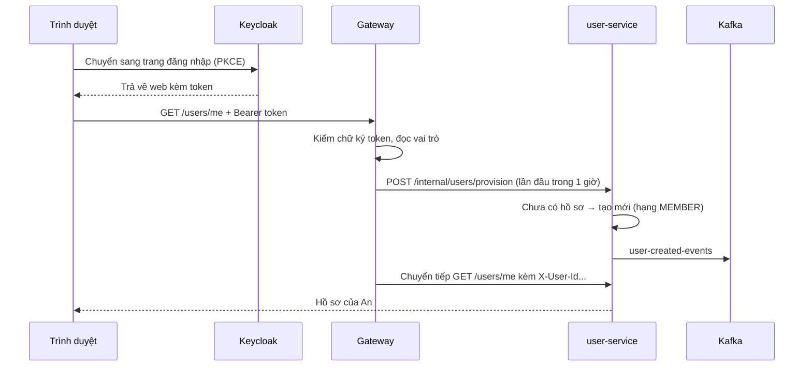

### Từng bước chi tiết

1. **Web khởi động:** thư viện keycloak-js kiểm tra im lặng "người này đã đăng nhập chưa" (`check-sso`). Web chỉ hiện
   giao diện sau khi kiểm tra xong.
2. **Bấm đăng nhập/đăng ký:** chuyển sang Keycloak. Có dùng **PKCE**: kỹ thuật chống kẻ gian chặn đường trả về để
   lấy trộm vé. Mật khẩu **chỉ Keycloak giữ**, web và các service không bao giờ thấy.
3. **Quay về web:** web gọi `GET /users/me` để chắc chắn hồ sơ được tạo. Nếu là ADMIN/STAFF thì tự chuyển sang `/admin`.
4. **Vé được giữ trong bộ nhớ** (không lưu localStorage, đỡ bị đánh cắp). Vé sống 15 phút; web **tự xin vé mới** mỗi
   60 giây và trước mỗi lần gọi API. Server trả 401 (vé hết hạn hoặc không hợp lệ) thì web đưa về trang đăng nhập.
5. **Gateway nhận yêu cầu:**
   - Kiểm chữ ký vé bằng khóa công khai lấy từ Keycloak.
   - Đọc vai trò; đường dẫn `/admin/**` chỉ cho ADMIN/STAFF; `/api/internal/**` **cấm hoàn toàn** từ bên ngoài.
   - **Xóa mọi header `X-User-*` do trình duyệt tự gửi** (chống giả danh), rồi tự gắn header thật lấy từ vé:
     `X-User-Id`, `X-User-Email`, `X-User-Roles`... Các service phía sau tin các header này.
6. **Tự tạo hồ sơ (provision):** gateway gọi user-service `/internal/users/provision`, có ghi nhớ trong Redis 1 giờ để
   không gọi lại liên tục. user-service:
   - Tìm theo id Keycloak; nếu chưa có mà **email đã tồn tại** (ví dụ trước đăng nhập bằng mật khẩu, nay bằng Google)
     thì gắn lại vào hồ sơ cũ.
   - Nếu chưa có gì: tạo hồ sơ mới, hạng **MEMBER**, rồi đăng `user-created-events`; marketing đọc tin này để chạy
     chiến dịch "thành viên mới".
   - Mỗi lần gọi đều đồng bộ lại tên, email, ảnh đại diện từ vé.
7. **Gọi nội bộ giữa các service** (đường `/api/internal/**`) phải kèm header `X-Internal-Api-Key`. Thiếu hoặc sai khóa
   thì bị từ chối. Đây là lý do phải khai báo `INTERNAL_API_KEY` trong `.env`.

### Phân quyền 2 lớp

- **Lớp 1, gateway:** chặn thô theo đường dẫn.
- **Lớp 2, từng service:** chặn chi tiết theo vai trò (`@PreAuthorize`). Ví dụ STAFF vào được trang admin nhưng
  xóa sản phẩm, đổi vai trò, hoàn tiền thì chỉ ADMIN.

**Code:** `FE/src/main.jsx`, `services/keycloak.js`, `services/apiClient.ts`; `api-gateway/.../SecurityConfig.java`,
`filter/UserHeaderFilter.java`; `user-service/.../UserServiceImpl.java`, `InternalUserController.java`.

---

## Luồng 2. Giỏ hàng

### Câu chuyện

> An bấm "Thêm vào giỏ" chiếc tai nghe. order-service kiểm tra kho còn hàng không rồi ghi vào giỏ của An. Khi An mở
> giỏ, hệ thống **hỏi lại giá hiện tại** của từng món. Nếu hôm qua bỏ vào giỏ mà hôm nay giảm giá, An thấy ngay giá mới.

### Chi tiết

- **Giỏ nằm trong Redis**, không nằm trong database: key `cart:{userId}`, tự xóa sau **30 ngày** không động đến.
- **Kiểm tra tồn kho khi thêm:** đọc số tồn nhanh trong Redis `product:stock:{sản phẩm}:{phiên bản}`. Nếu Redis chưa có
  thì hỏi inventory-service qua gRPC rồi ghi vào Redis, có khóa để nhiều người cùng hỏi không gọi kho dồn dập.
  - Thêm quá số tồn → báo lỗi "không đủ hàng".
  - Kho không trả lời → **vẫn cho thêm vào giỏ** (thiết kế "mở khi lỗi": việc này chưa mất tiền, đến lúc đặt hàng mới
    kiểm tra gắt).
- **Giá không lưu trong giỏ:** mỗi lần xem giỏ, order-service hỏi product-service giá mới qua gRPC. Phiên bản (màu,
  dung lượng) có giá riêng thì lấy giá phiên bản.
- Mỗi lần thêm/sửa/xóa, order-service đăng tin `cart-updated-events`; phần AI dùng tin này để ghi hành vi
  "thêm vào giỏ" (luồng 13).

**Code:** `order-service/.../CartServiceImpl.java`, `grpc/ProductGrpcClient.java`, `grpc/InventoryGrpcClient.java`.

---

## Luồng 3. Đặt hàng: từ bấm nút đến khi đơn được lưu

### Câu chuyện

> An vào trang thanh toán, chọn voucher giảm 10% và dùng 20 điểm thưởng. Trang hiện tổng tiền do **server** tính. An
> bấm **Đặt hàng**. Trong chưa đầy một giây, server: kiểm tra không phải bấm trùng, **giữ chỗ** tai nghe trong Redis để
> người khác không mua mất, lưu đơn ở trạng thái **PENDING**, giữ chỗ voucher, trừ 20 điểm, rồi bỏ "thư" *có đơn mới*
> vào hộp thư outbox. Giỏ hàng được xóa.

### Bước 1: Xem trước tiền (preview)

Trang checkout gọi `POST /orders/checkout/preview`. Server tính, **không tin số tiền trình duyệt gửi lên**:

| Thành phần | Cách tính |
|---|---|
| Tạm tính | Tổng (giá hiện tại × số lượng), lấy từ product-service |
| Giảm giá voucher | Hỏi promotion-service (chỉ kiểm tra, **chưa giữ chỗ**). Voucher %: tạm tính × % nhưng không quá mức giảm tối đa. Voucher tiền mặt: cần đơn đạt giá trị tối thiểu. Voucher freeship: trừ vào phí ship |
| Giảm bằng điểm | Số điểm × 1.000đ, không vượt quá phần còn lại |
| Thuế VAT | **10%** của (tạm tính − voucher − điểm) |
| Phí vận chuyển | Cố định **30.000đ** |
| **Tổng** | (tạm tính − voucher − điểm) + VAT + phí ship − giảm ship, không âm |

**Ví dụ:** tai nghe 1.000.000đ, voucher 10% (tối đa 50.000đ), dùng 20 điểm.

```
Tạm tính                    1.000.000
− Voucher 10% (chạm trần)     −50.000
− 20 điểm × 1.000            −20.000
= Phần chịu thuế              930.000
+ VAT 10%                     +93.000
+ Phí ship                    +30.000
= TỔNG                      1.053.000 đ
```

### Bước 2: Bấm "Đặt hàng" (`POST /orders/checkout`)

1. **Chống bấm trùng:** mỗi lần mở trang checkout, web tạo một mã `Idempotency-Key`. Server ghi vào Redis
   `checkout:lock:{user}:{mã}` (sống 15 phút):
   - đang xử lý mà nhận lần hai → trả lỗi 409 "đang xử lý";
   - đã xong → trả lại **đúng đơn cũ**, không tạo đơn mới;
   - thất bại → xóa mã để được thử lại.
2. **Giữ chỗ hàng trong Redis:** với từng món, chạy một đoạn script Lua trên Redis. Script chạy **nguyên khối**, không
   ai chen ngang được: "nếu còn ≥ số cần mua thì trừ, không thì báo thiếu". Đây là chốt chặn chính để **hai người không
   cùng mua được món cuối cùng**. Ở bước này nếu kho không trả lời thì **từ chối đặt hàng** (thiết kế "đóng khi lỗi",
   ngược với giỏ hàng, vì sắp mất tiền thật).
3. **Lưu đơn** (`orders`, `order_items`) trạng thái **PENDING**.
4. **Giữ chỗ voucher:** gọi promotion-service `/vouchers/apply`; voucher chuyển **RESERVED** (giữ chỗ) và gắn với đơn
   này. Lỗi thì hủy đơn, báo voucher không hợp lệ.
5. **Trừ điểm thưởng ngay lúc này** (không đợi xác nhận): gọi user-service `/points/redeem`. Server tự giới hạn không
   dùng quá số điểm đang có. Lỗi thì hủy đơn, trả voucher.
6. **Bỏ thư vào outbox:** ghi `OrderCreatedEvent` (mã đơn, người mua, danh sách món: sản phẩm, phiên bản, số lượng).
7. **Xóa giỏ hàng.** Trả kết quả cho web.
8. **Nếu có lỗi bất ngờ ở giữa:** đơn đã lưu thì chuyển CANCELLED và gửi thư "đã hủy" để các bên bù trừ; đơn chưa lưu
   thì trả lại số lượng đã giữ trong Redis.

### Bước 3: Debezium mang thư lên Kafka

Debezium thấy dòng mới trong `outbox_events` → đăng lên topic **`order-events`**, khóa tin (key) là mã đơn, nên mọi tin
của cùng một đơn luôn đến **đúng thứ tự**.

> **Vì sao giữ chỗ ở Redis rồi kho còn trừ lại?** Redis để **chặn nhanh** ngay lúc bấm (hàng nghìn người cùng bấm vẫn
> chịu được). Database của kho là **sổ chính thức** để đối soát. Hai lớp này giống "phiếu giữ chỗ" ở quầy và "phiếu
> xuất kho" ở kho.

**Code:** `order-service/.../OrderServiceImpl.java` (checkout, preview), `support/OrderPricingHelper.java`,
`support/ShippingFeeCalculator.java`, `config/RedisLuaScripts.java`; `promotion-service/.../VoucherRedemptionServiceImpl.java`;
`user-service/.../LoyaltyPointServiceImpl.java`; cấu hình Debezium trong `BE/docker-compose-infra.yml`.

---

## Luồng 4. Kho xác nhận giữ hàng

### Câu chuyện

> inventory-service đọc tin "đơn #12 mới: 1 tai nghe". Nó khóa dòng tồn kho của tai nghe, trừ 1, ghi sổ "DEDUCT
> đơn #12", rồi đăng lên bảng tin `inventory-events`: "đơn #12: đã giữ hàng". order-service đọc tin đó và chuyển đơn
> sang **AWAITING_PAYMENT** (chờ thanh toán).

### Chi tiết

1. **Khóa theo đơn** trong Redis (`lock:inventory-consumer:{mã đơn}`) để cùng một đơn không bị xử lý song song.
2. **Kiểm tra đã làm chưa:** nếu sổ đã có dòng `DEDUCT` cho đơn này (tin bị giao lại) thì chỉ gửi lại xác nhận, **không
   trừ lần hai**. Nếu đơn đã bị hủy trước đó (có dòng `CANCEL_RECEIVED`) thì bỏ qua.
3. **Trừ kho:** sắp xếp các món theo thứ tự cố định, tránh hai đơn khóa chéo nhau (deadlock). Khóa từng dòng
   (`SELECT ... FOR UPDATE`), trừ số lượng, ghi giao dịch `DEDUCT`.
4. **Trả lời:** đăng `InventoryDeductedEvent` với trạng thái `CONFIRMED` hoặc `FAILED` lên topic `inventory-events`.
5. **order-service nhận:**
   - `CONFIRMED` → đơn chuyển **AWAITING_PAYMENT**;
   - `FAILED` → đơn chuyển **CANCELLED** (kèm trả voucher, hoàn điểm).
6. **Lỗi hệ thống** (database tạm hỏng): thử lại 3 lần, cách 2→10 giây. Vẫn hỏng thì chuyển tin sang "hàng đợi lỗi"
   (dead-letter topic) để xem sau.

> **Quy tắc không lùi trạng thái:** mỗi trạng thái có một "bậc":
> PENDING 1 < AWAITING_PAYMENT 2 < CONFIRMED 3 < SHIPPED 4 < DELIVERED 5 < CANCELLED 6.
> order-service **chỉ cho đi lên bậc**, tin đến muộn muốn kéo lùi sẽ bị bỏ qua. Nhờ vậy dù các tin Kafka đến lệch thứ
> tự, trạng thái đơn vẫn đúng.

**Code:** `inventory-service/.../InventoryKafkaConsumer.java`, `InventoryDeductService.java`;
`order-service/.../event/consumer/InventoryKafkaConsumer.java`, `OrderServiceImpl.updateOrderStatus`.

---

## Luồng 5. Thanh toán COD và VNPay

### Chung cho cả hai

Web gọi `POST /payments/initiate` với mã đơn và phương thức. payment-service:

1. Khóa theo đơn trong Redis 15 giây (chống bấm trùng).
2. Hỏi order-service: đơn này có đúng của bạn không, có đang PENDING/AWAITING_PAYMENT không, và **số tiền thật** là bao
   nhiêu. Số tiền luôn lấy từ server, không lấy từ trình duyệt.
3. Tạo (hoặc dùng lại) một dòng trong bảng `payments`, trạng thái `PENDING`.

### COD (trả tiền khi nhận hàng)

> An chọn COD. payment-service bỏ thư `PaymentCODConfirmedEvent` vào outbox của mình → Debezium → `payment-events`
> → order-service chuyển đơn **CONFIRMED**. Khoản thanh toán vẫn **PENDING**, đến khi shipper giao xong (đơn
> DELIVERED) mới thành **SUCCESS**.

### VNPay

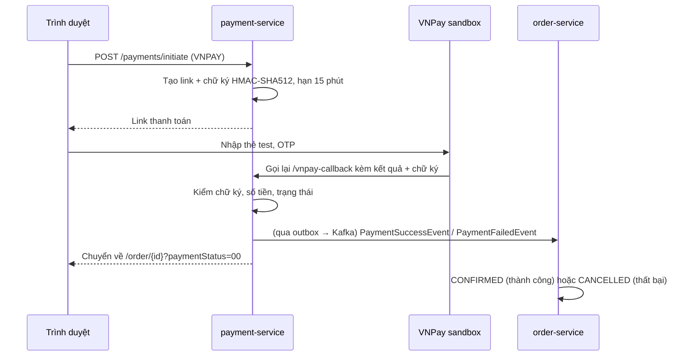

1. **Tạo link:** gồm số tiền (×100 theo quy ước VNPay), mã giao dịch ngẫu nhiên, hạn 15 phút. Các tham số được sắp
   xếp rồi **ký bằng HMAC-SHA512** với khóa bí mật chỉ server và VNPay biết, nên ai sửa số tiền trên link thì chữ ký
   sai ngay.
2. **Khách trả tiền trên trang VNPay.**
3. **VNPay gọi lại hệ thống** (`/public/payments/vnpay-callback`). payment-service kiểm tra lần lượt:
   chữ ký đúng không (sai → mã 97), có giao dịch này không (01), số tiền khớp không (04), giao dịch còn đang chờ không (02).
4. **Kết quả:**
   - mã `00` → `SUCCESS` → đăng `PaymentSuccessEvent` → đơn **CONFIRMED**;
   - mã khác (khách hủy, thẻ lỗi) → `FAILED` → `PaymentFailedEvent` → **đơn bị hủy**, kho được trả.
5. Trình duyệt được chuyển về trang đơn hàng `/order/{id}?paymentStatus=...`.

### Các trường hợp "lạ"

- **Khách bỏ ngang không trả tiền:** cứ 5 phút, payment-service tìm các giao dịch VNPay chờ quá 15 phút và **hỏi thẳng
  VNPay** "giao dịch này thế nào rồi?":
  - VNPay nói đã trả → SUCCESS;
  - chưa trả / không có → EXPIRED → hủy đơn;
  - không rõ → đợi lần sau.
  Đơn COD không bị quét kiểu này.
- **Trả tiền sau khi đơn đã hết hạn/hủy:** không thể "hồi sinh" đơn, nên hệ thống tạo yêu cầu **hoàn tiền** tự động.

**Code:** `payment-service/.../PaymentServiceImpl.java`, `controller/WebhookController.java`, `scheduler/PaymentScheduler.java`;
`order-service/.../event/consumer/PaymentKafkaConsumer.java`.

---

## Luồng 6. Sau khi đơn được xác nhận

Đây là chỗ thấy rõ sức mạnh của Kafka: **một sự kiện, nhiều bên cùng phản ứng**, và order-service không cần biết ai.

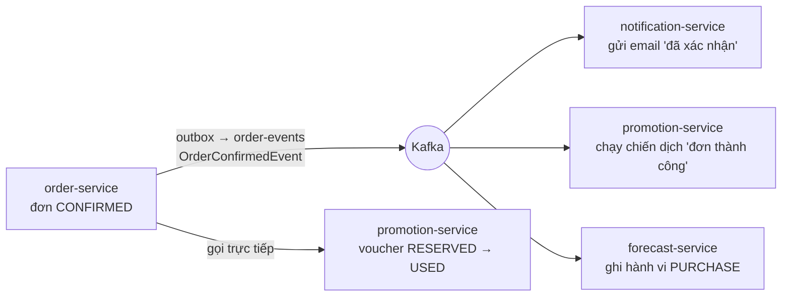

1. order-service bỏ thư `OrderConfirmedEvent` vào outbox.
2. Sau khi lưu xong, gọi promotion-service chuyển voucher của đơn từ **RESERVED** sang **USED** (đã dùng).
3. Các bên đọc `order-events`:
   - **notification-service** gửi email "đơn đã xác nhận" (luồng 12);
   - **promotion-service** tìm các chiến dịch có trigger "Đơn thành công" để chạy (luồng 11);
   - **forecast-service** ghi mỗi món trong đơn thành một dòng `PURCHASE` vào `user_events` (luồng 13).

---

## Luồng 7. Giao hàng, bảo hành, đánh giá

1. **Admin bấm "Xác Nhận Giao Hàng"** (`PUT /orders/{id}/ship`, chỉ ADMIN/STAFF, đơn phải CONFIRMED): đơn → **SHIPPED**,
   sinh mã vận đơn **giả lập** `MOCK-GHTK-xxxx` (chưa nối hãng vận chuyển thật), đăng `OrderShippedEvent` → email "đang giao".
2. **Cập nhật giao vận:** có 2 cửa vào, cùng một xử lý:
   - admin bấm nút trên trang quản trị (`PUT /orders/{id}/delivery-status`);
   - **webhook** cho hãng vận chuyển gọi (`POST /public/orders/shipping-webhook`), có chữ ký HMAC-SHA256 bằng
     `SHIPPING_WEBHOOK_SECRET` để không ai giả mạo được.
3. **Đã giao** → **DELIVERED** → `OrderDeliveredEvent`:
   - email "đã giao";
   - payment-service chuyển khoản COD thành **SUCCESS** (đã thu tiền).
4. **Bảo hành:** tab Bảo hành lấy các đơn **DELIVERED**, hỏi product-service thời hạn bảo hành từng sản phẩm.
   Hạn bảo hành = **ngày đặt đơn** + số tháng. Sản phẩm 0 tháng không hiện.
5. **Đánh giá:** product-service hỏi order-service "người này đã mua và nhận (hoặc đang giao) sản phẩm này chưa?" rồi
   mới cho viết. Đánh giá xong đăng `product-reviewed-events`, marketing có thể chạy chiến dịch "đánh giá → tặng điểm".

**Code:** `order-service/.../OrderServiceImpl.java` (ship, delivery-status, warranty),
`PublicShippingWebhookController.java`, `InternalOrderController.java`; `product-service/.../ReviewServiceImpl.java`.

---

## Luồng 8. Hủy đơn, tự hủy đơn bỏ dở, hoàn tiền

### Khi khách (hoặc admin) bấm hủy

- **Được hủy** khi đơn đang PENDING, AWAITING_PAYMENT hoặc CONFIRMED. Đã SHIPPED thì khách không hủy được; admin dùng
  nút "Hủy Giao Hàng".
- **Giai đoạn 1** (một lần lưu): đơn → **CANCELLED** + thư `OrderCancelledEvent` (kèm danh sách món).
- **Giai đoạn 2:** gọi promotion-service trả voucher, gọi user-service hoàn điểm. Nếu lúc đó service kia đang tắt, việc
  bù được ghi vào bảng `compensation_tasks` và **tự thử lại mỗi 5 phút, tối đa 10 lần**.

### Các bên bù trừ khi đọc `OrderCancelledEvent`

| Bên | Làm gì |
|---|---|
| Kho | Đã trừ (`DEDUCT`) thì cộng trả (`RELEASE`) và cộng lại Redis. Chưa kịp trừ thì ghi dấu `CANCEL_RECEIVED`, để nếu tin "đơn mới" đến muộn sẽ **không trừ nữa** |
| Voucher | Chỉ trả về ví nếu đang **RESERVED**. Voucher đã **USED** (đơn đã xác nhận) thì **không trả lại** |
| Điểm | Hoàn đúng số đã trừ (chỉ hoàn 1 lần cho mỗi đơn) |
| Thanh toán | Đang chờ → FAILED. Đã trả VNPay → tạo yêu cầu hoàn tiền; mỗi phút một job gọi **API hoàn tiền của VNPay sandbox**. COD chưa thu tiền thì coi như hoàn xong |
| Email | Gửi "đơn đã hủy" |

### Tự hủy đơn bỏ dở

Mỗi 5 phút, order-service tìm đơn **PENDING / AWAITING_PAYMENT quá 30 phút** và hủy như trên. Có khóa Redis để nếu
chạy nhiều bản order-service thì chỉ một bản làm.

---

## Tổng kết: vòng đời một đơn hàng

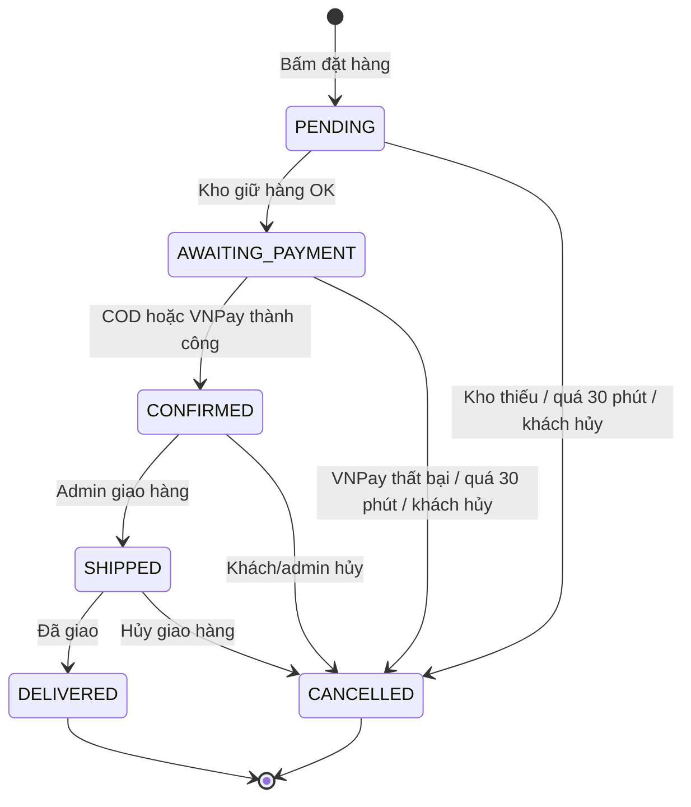

| Trạng thái | Nghĩa | Ai chuyển sang |
|---|---|---|
| PENDING | Đơn vừa lưu, chờ kho | order-service lúc checkout |
| AWAITING_PAYMENT | Kho đã giữ hàng, chờ trả tiền | inventory-service (qua Kafka) |
| CONFIRMED | Đã thanh toán / chọn COD | payment-service (qua Kafka) |
| SHIPPED | Đang giao | Admin / webhook vận chuyển |
| DELIVERED | Đã giao (trạng thái cuối) | Admin / webhook vận chuyển |
| CANCELLED | Đã hủy (trạng thái cuối) | Khách, admin, kho, thanh toán, job tự hủy |

> Với COD, web thường gọi thanh toán ngay sau khi đặt, nên đơn có thể nhảy từ PENDING lên CONFIRMED trước cả khi kho
> trả lời. Tin "kho đã giữ hàng" đến sau sẽ bị bỏ qua nhờ quy tắc không lùi bậc.

---

## Luồng 9. Voucher

**Hệ thống không có voucher tạo sẵn.** Voucher chỉ sinh ra khi một **chiến dịch** phát cho khách (luồng 11).

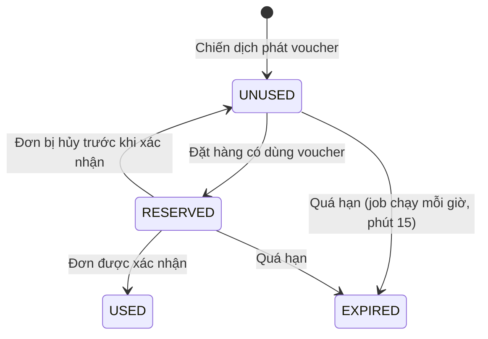

- **3 loại:** giảm % (có mức trần), giảm tiền cố định (cần đơn tối thiểu), miễn phí ship (có mức trần).
- **Khi kiểm tra voucher**, promotion-service xét: đúng chủ, còn hạn, đang UNUSED, sản phẩm/danh mục trong đơn có thuộc
  phạm vi áp dụng không.
- **Mã voucher** dạng `VPC-...` (%), `VPF-...` (tiền), `VFS-...` (freeship).
- **Ngân sách:** mỗi lần phát voucher, chiến dịch bị trừ ngân sách theo mức giảm **tối đa có thể** của voucher đó.
  Hết ngân sách thì ngừng phát. Voucher hết hạn thì ngân sách được trả lại.

---

## Luồng 10. Điểm thưởng và hạng thành viên

| Quy tắc | Giá trị |
|---|---|
| Tích điểm (khi chiến dịch dùng chế độ "theo giá trị đơn") | 10.000đ = 1 điểm, nhân hệ số hạng: SILVER ×1,2; GOLD ×1,5; VIP ×2 |
| Dùng điểm | 1 điểm = 1.000đ, không vượt quá số điểm đang có và số tiền phải trả |
| Hạng | MEMBER → SILVER → GOLD → VIP |

- **Điểm KHÔNG tự cộng sau mỗi đơn.** Điểm chỉ được cộng khi một chiến dịch có hành động "Cộng điểm" chạy, với 2 chế độ:
  cố định (FIXED, ví dụ +100) hoặc theo giá trị đơn (ORDER_SPEND).
- **Hạng KHÔNG tự lên theo chi tiêu.** Hạng chỉ đổi khi admin đổi tay hoặc chiến dịch có hành động "Nâng hạng".
- Mỗi lần điểm thay đổi đều ghi một dòng vào `loyalty_point_transactions` (cộng/trừ bao nhiêu, số dư sau, lý do, đơn
  nào). Trừ và hoàn theo từng đơn đều **chỉ làm 1 lần** dù bị gọi lại.

---

## Luồng 11. Chiến dịch tự động bằng Camunda

### Câu chuyện

> Chị quản lý muốn: *"Khách nào có đơn từ 100.000đ thì cộng 100 điểm và tặng voucher 10%."* Chị không cần nhờ lập
> trình viên. Chị vào tab **Coupon Code**, kéo 4 khối: **Đơn thành công (≥100.000đ) → Cộng 100 điểm → Voucher 10% →
> Kết thúc**, đặt ngân sách và thời gian, bấm **Deploy**. Từ phút đó, mỗi đơn đủ điều kiện, hệ thống tự cộng điểm và
> tặng voucher cho khách.

### 11.1 Các khối có trong trình dựng

| Nhóm | Khối |
|---|---|
| **Khi nào** (trigger, đúng 1 khối) | Người dùng mới · Đơn thành công (có giá trị tối thiểu) · Đánh giá sản phẩm (có số sao tối thiểu) · Nguy cơ rời bỏ (từ AI) · Hẹn giờ (cron) |
| **Nếu** (điều kiện, rẽ nhánh) | Hạng thành viên · Tổng chi tiêu (N ngày gần đây) · Địa chỉ · Đơn chứa danh mục · Đơn chứa sản phẩm · Mức rủi ro churn |
| **Thì** (hành động) | Voucher % · Voucher tiền · Voucher freeship · Cộng điểm · Nâng hạng · Gửi email |
| Kết thúc | End |

### 11.2 Bấm Deploy thì chuyện gì xảy ra

1. Web gửi sơ đồ dạng JSON (các khối và các mũi tên).
2. **Kiểm tra hợp lệ:** đúng 1 trigger, có ít nhất 1 kết thúc, không có khối "mồ côi", không có vòng lặp. Khối điều kiện
   phải có ≥ 2 nhánh, trong đó **đúng 1 nhánh mặc định**. Voucher % phải từ 1–100. Có phát voucher thì phải có ngân sách...
3. **Dịch sang BPMN:**

   | Khối trên giao diện | Thành phần BPMN |
   |---|---|
   | Trigger sự kiện | Sự kiện bắt đầu (start event) |
   | Trigger hẹn giờ | Sự kiện bắt đầu kiểu hẹn giờ (timer, cron) |
   | Điều kiện | Cổng rẽ nhánh (exclusive gateway) + biểu thức trên mỗi mũi tên, ví dụ `${memberRank == 'VIP'}` |
   | Hành động | Ô công việc (service task) gọi đến đoạn code Java tương ứng (delegate) |
   | Mũi tên | Luồng tuần tự (sequence flow) |

4. **Nạp vào Camunda** (deploy), lưu chiến dịch kèm mã quy trình, bản BPMN và **ngân sách còn lại = ngân sách ban đầu**.
   Sửa chiến dịch thì Camunda giữ phiên bản cũ và nạp **phiên bản mới**.

### 11.3 Khi có sự kiện: chiến dịch được kích hoạt thế nào

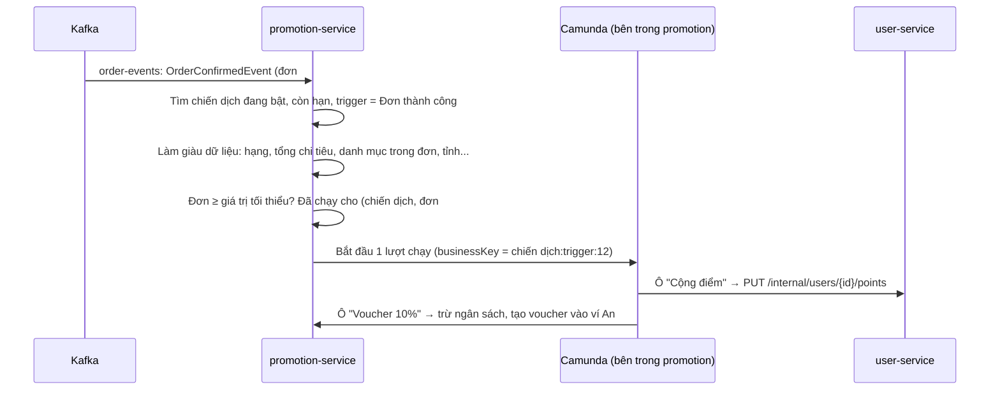

1. **Nguồn sự kiện** (promotion-service đọc 5 bảng tin):

   | Topic | Sự kiện | Kích hoạt trigger |
   |---|---|---|
   | `user-created-events` | Người dùng mới | Người dùng mới |
   | `order-events` | Đơn được xác nhận | Đơn thành công |
   | `payment-events` | Thanh toán thành công | Đơn thành công |
   | `product-reviewed-events` | Có đánh giá mới | Đánh giá sản phẩm |
   | `user-risk-events` | AI phát hiện khách có nguy cơ rời bỏ | Nguy cơ rời bỏ |

2. **Tìm chiến dịch phù hợp:** đang bật, **ngày hiện tại nằm trong khoảng bắt đầu–kết thúc**, đúng loại trigger.
3. **Làm giàu dữ liệu** (để các điều kiện có cái mà so): hỏi user-service hạng thành viên, email; hỏi order-service tổng
   tiền đơn và các sản phẩm; hỏi product-service danh mục của các sản phẩm; tính tổng chi tiêu N ngày; tỉnh giao hàng.
4. **Lọc theo trigger:** đơn chưa đạt giá trị tối thiểu, hoặc đánh giá chưa đủ sao, thì không chạy.
5. **Chống chạy trùng:** mỗi lượt chạy có "mã nghiệp vụ" `mã chiến dịch:loại trigger:mã định danh` (mã đơn, mã đánh
   giá, mã người dùng...). Đơn VNPay sinh ra cả "thanh toán thành công" lẫn "đơn xác nhận", nhưng hai tin cùng mã đơn
   nên **chỉ chạy 1 lần**. Có thêm khóa Redis 30 giây chống hai tin đến cùng lúc.
6. **Camunda chạy quy trình:** đến cổng rẽ nhánh thì tính biểu thức (ví dụ `memberRank == 'GOLD'`) để chọn nhánh; đến ô
   hành động thì gọi code tương ứng:
   - **Voucher:** trừ ngân sách chiến dịch (khóa dòng, không đủ thì dừng) → tạo voucher vào ví khách. Có mã chống trùng
     theo từng ô trong từng lượt chạy.
   - **Cộng điểm:** gọi user-service, có kiểm tra "ô này trong lượt này đã cộng chưa".
   - **Gửi email:** gọi notification-service với mẫu email đã chọn.
   - **Nâng hạng:** gọi user-service đổi hạng.
7. **Thống kê** ở tab Thống kê Promotion được **tính khi mở xem**: số voucher đã phát/đã dùng, ngân sách còn lại, số
   lượt đang chạy trong Camunda.

### 11.4 Bật/tắt, xóa, hẹn giờ

- **Tắt chiến dịch:** tạm ngưng quy trình trong Camunda, đồng thời không còn được chọn ở bước 2.
- **Xóa** (chỉ ADMIN): xóa bản ghi chiến dịch. Bản quy trình đã nạp vào Camunda **vẫn còn** (xem phụ lục B).
- **Hẹn giờ:** Camunda tự đếm giờ và khởi động quy trình theo cron. Lượt chạy này **không gắn với khách cụ thể** nên các
  hành động cần khách (phát voucher, cộng điểm) sẽ bị bỏ qua.

**Code:** `FE/src/features/admin/components/campaigns/`; `promotion-service/.../WorkflowValidatorService.java`,
`BpmnCompilerService.java`, `CampaignServiceImpl.java`, `CampaignTriggerService.java`, `CampaignVariableEnricher.java`,
`delegate/*Delegate.java`, `PromotionKafkaConsumer.java`.

---

## Luồng 12. Gửi email

- notification-service **chỉ đọc bảng tin**, không ai gọi nó trực tiếp; riêng chiến dịch "Gửi email" thì gọi qua
  đường nội bộ.

  | Bảng tin | Sự kiện → mẫu email |
  |---|---|
  | `order-events` | Đã xác nhận · Đã hủy · Đang giao · Đã giao |
  | `payment-events` | Thanh toán thành công · Thanh toán thất bại |

- **Địa chỉ nhận** lấy từ email có sẵn trong sự kiện (email trong token của khách lúc đặt hàng). Không có thì dùng
  `{userId}@ecommerce.com` (địa chỉ giả).
- **Mẫu email** lưu trong MongoDB (tự tạo sẵn khi service khởi động), điền thông tin bằng cách thay các chỗ `{{tên}}`.
- **Chống gửi trùng:** mỗi (đơn, loại sự kiện) chỉ gửi 1 lần.
- **Gửi:** lưu bản ghi PENDING → gửi qua SMTP (Gmail) → SENT hoặc FAILED. Chưa cấu hình SMTP thì chỉ ghi log.
- **Thông báo đẩy (FCM):** chỉ lưu token thiết bị và ghi log, chưa gửi thật.

**Code:** `notification-service/.../NotificationKafkaConsumer.java`, `NotificationServiceImpl.java`,
`config/NotificationTemplateSeeder.java`.

---

## Luồng 13. Theo dõi hành vi người dùng

### Câu chuyện

> An lướt web: xem 3 chiếc tai nghe, cuộn hết trang, phóng to ảnh, lọc theo giá, thêm 1 chiếc vào giỏ. Mỗi hành động
> được ghi lại **âm thầm**. Cứ 10 giây, trình duyệt gom các hành động gửi lên server một lần. Vài giây sau, chúng nằm
> trong bảng `user_events`; hai hành động "xem" và "thêm giỏ" còn được ghi vào danh sách "vừa xem gần đây" của An
> trong Redis, để trang chủ gợi ý ngay.

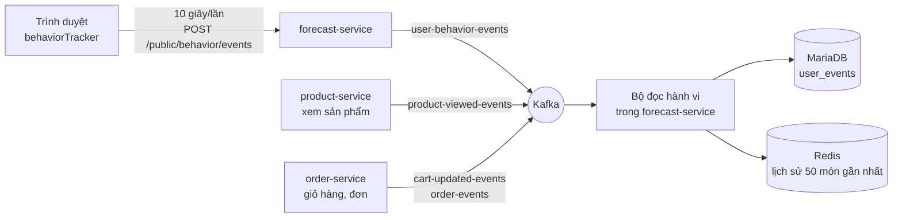

### Chi tiết

1. **Phía trình duyệt** (`behaviorTracker.ts`):
   - Mỗi tab có một **mã phiên** (session id) lưu trong `sessionStorage`. Khách chưa đăng nhập vẫn được theo dõi theo phiên.
   - **Tự ghi:** ẩn/hiện tab, cuộn trang (mốc 25/50/75/100%), thời gian ở lại trang, sản phẩm **được hiển thị** (tối đa
     20 món mỗi danh sách, kèm vị trí và nguồn: gợi ý / gần đây / xu hướng / tìm kiếm / danh mục).
   - **Các trang tự báo:** xem giỏ, bắt đầu checkout, xem phí ship, áp voucher thành công/thất bại, tìm kiếm, lọc, sắp xếp, phóng ảnh.
   - **Gửi:** 10 giây/lần, hoặc khi đủ 200 sự kiện, hoặc khi đóng/ẩn tab (dùng `sendBeacon` để tab đóng rồi vẫn gửi được).
   - Không gửi user id trong nội dung: gateway tự gắn `X-User-Id` từ token, nên **không ai giả được hành vi của người khác**.
2. **forecast-service nhận:** kiểm tra loại hành động hợp lệ (14 loại), giá trị hợp lệ, tối đa 200 sự kiện/lần, rồi
   đăng lên `user-behavior-events`, khóa theo session để giữ đúng thứ tự.
3. **Hai hành động quan trọng nhất do backend tự báo** (đáng tin hơn, không bị trình chặn quảng cáo chặn):
   - **xem sản phẩm** ← product-service (`product-viewed-events`);
   - **thêm/sửa/xóa giỏ** ← order-service (`cart-updated-events`).
4. **Bộ đọc hành vi** đọc 4 bảng tin và ghi vào `user_events` (`user_id, session_id, item_id, category_id, action_type,
   weight, source, created_at`):

   | Nguồn | Ghi thành | Cột `weight` chứa |
   |---|---|---|
   | Xem sản phẩm | `VIEW_PRODUCT` | trống |
   | Giỏ hàng | `ADD_TO_CART`, `UPDATE_CART_QTY`, `REMOVE_FROM_CART`, `CLEAR_CART` | trống |
   | Hành vi từ trình duyệt | Giữ nguyên tên (SCROLL_DEPTH, PAGE_DWELL, IMPRESSION...) | % cuộn, số giây, vị trí hiển thị |
   | Đơn được xác nhận | `PURCHASE`, mỗi món một dòng | số lượng |

5. **Redis:** chỉ `VIEW_PRODUCT` và `ADD_TO_CART` được đẩy vào danh sách `user:{id}:history` (hoặc `session:{id}:history`
   với khách chưa đăng nhập): giữ **50 món gần nhất**, sống 30 ngày.

**Code:** `FE/src/services/behaviorTracker.ts`; `AI/forecast-service/app/api/endpoints/forecast.py`,
`app/kafka/behavior_producer.py`, `app/kafka/behavior_consumer.py`; `AI/shared-common/shared_common/contracts.py`.

---

## Luồng 14. Gợi ý sản phẩm

### Câu chuyện

> Trang chủ của An có 3 tab. **Xem gần đây** đơn giản là các món An vừa xem. **Xu hướng** là món được xem/thêm giỏ
> nhiều nhất 30 ngày qua. **Gợi ý cho bạn** thông minh nhất: model **SASRec** đọc *chuỗi* món An vừa xem theo thứ tự
> (tai nghe A → tai nghe B → hộp sạc) và đoán "người xem chuỗi như vậy thường xem gì tiếp", giống YouTube gợi ý video tiếp theo.

### Cây quyết định

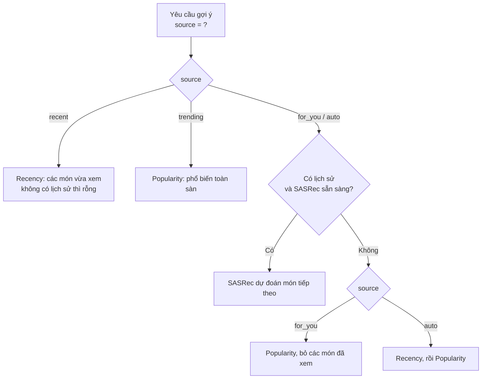

Header **`X-Recs-Strategy`** của phản hồi cho biết lần này dùng `sasrec`, `recency` hay `popularity`.

### Chi tiết

- **Nhận diện người dùng:** từ header `X-User-Id` (gateway gắn) hoặc `X-Session-Id`. Đọc lịch sử user trước, rỗng thì
  đọc lịch sử phiên.
- **Popularity:** điểm = số lượt xem + 3 × số lượt thêm giỏ trong 30 ngày, lấy top 100, nhớ đệm 5 phút.
- **SASRec chạy thế nào:**
  1. Lấy tối đa 50 món gần nhất từ Redis, đảo về đúng thứ tự thời gian, giữ **15 món cuối**.
  2. Đổi mã sản phẩm thành số thứ tự trong "từ điển" của model (1.123 sản phẩm); món không có trong từ điển bị bỏ.
  3. Model (Transformer nhỏ: 1 khối, 2 đầu chú ý, vector 32 chiều) đọc chuỗi và cho mỗi sản phẩm một điểm.
  4. **Loại bỏ các món đã có trong lịch sử**, lấy top K.
- **Cổng chất lượng (evaluation gate):** model chỉ được dùng nếu khi huấn luyện, nó **thắng hoặc bằng** thuật toán đơn
  giản tốt nhất (Popularity, Markov, phổ biến theo danh mục, ItemKNN) trên chỉ số HR@10. Model hiện tại: HR@10 = 0,0499
  so với 0,0340 của Category-Pop, **đạt cổng**. Không đạt thì hệ thống tự dùng Popularity.
- **Gợi ý mua kèm ở giỏ hàng:** hiện trả về danh sách phổ biến (chưa phân tích "hay mua cùng nhau").

**Code:** `AI/recs-service/app/api/endpoints/recommend.py`, `app/services/sasrec.py`, `popularity.py`, `recency.py`;
`AI/recs-service/evaluation/train_serving.py`.

---

## Luồng 15. Tìm kiếm ngữ nghĩa lai (Semantic & Hybrid Search)

### 15.1 Chuẩn bị trước: dựng chỉ mục văn bản (làm 1 lần, chạy lại khi thêm sản phẩm)

Script `build_index.py`:
1. Lấy mọi sản phẩm đang bán từ MariaDB (kèm thương hiệu, danh mục, thông số).
2. **Chữ:** ghép "tên. Thương hiệu… Danh mục… mô tả" → model **multilingual-e5-large** biến thành vector **1.024 số** → lưu vào FAISS.
3. Tính sẵn "sản phẩm tương tự" dựa trên khoảng cách vector văn bản, lưu MongoDB `product_similarities`.
4. Ghi file chỉ mục mới **thay nguyên khối** file cũ; service đang chạy tự nhận file mới trong vòng 30 giây, không cần khởi động lại.

### 15.2 Tìm kiếm ngữ nghĩa lai

> Gõ "tai nghe chống ồn đi máy bay": tìm theo từ khóa thì bỏ sót sản phẩm ghi "ANC", còn tìm theo nghĩa thì hiểu
> được. Hệ thống làm **cả hai** rồi trộn kết quả.

1. **Theo nghĩa:** e5 biến câu hỏi thành vector (thêm tiền tố `query:`) → FAISS tìm sản phẩm gần nhất.
2. **Theo từ khóa:** Elasticsearch BM25 tìm trên tên (trọng số 3), thương hiệu, danh mục (2), mô tả (1), cho phép gõ sai
   nhẹ. Elasticsearch hỏng thì dùng tạm `LIKE` của MariaDB.
3. **Trộn bằng RRF:** mỗi sản phẩm được cộng điểm `1 / (60 + thứ hạng)` từ mỗi danh sách mà nó có mặt. Sản phẩm đứng cao
   ở **cả hai** danh sách sẽ lên đầu. Ưu điểm: không cần so trực tiếp hai loại điểm khác thang đo.
4. Lọc theo khoảng giá (nếu có).

> **Lưu ý:** ô tìm kiếm trên web hiện **chưa** gọi tìm kiếm ngữ nghĩa này (gọi tìm kiếm thường của product-service).
> Tìm kiếm ngữ nghĩa thử qua http://localhost:8001/docs.

**Code:** `AI/search-service/scripts/build_index.py`, `hybrid_search.py`, `text_search.py`, `faiss_store.py`, `catalog.py`.

---

## Luồng 16. Dự đoán khách rời bỏ (churn) và tự động giữ chân

### Câu chuyện

> Chị Bình từng mua 4 đơn, đơn gần nhất cách đây 5 tháng. Tuần này chị vào xem vài món, thêm 1 món vào giỏ rồi bỏ đó.
> Mỗi giờ, AI chấm điểm mọi khách: chị Bình thuộc nhóm **At Risk**, xác suất rời bỏ 0,62 (cao hơn ngưỡng), lại vừa
> **bỏ giỏ**. AI đăng tin "khách có nguy cơ rời bỏ". promotion-service bắt được, chạy chiến dịch "Nguy cơ rời bỏ" và
> **tặng chị voucher 15%**. Không cần nhân viên nào làm gì.

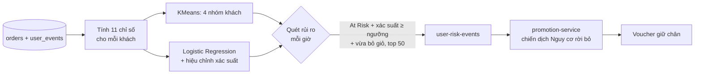

### 16.1 Mười một chỉ số mô tả một khách

| # | Chỉ số | Nghĩa | Lấy từ |
|---|---|---|---|
| 1 | `recency` | Bao nhiêu ngày từ đơn đã giao gần nhất | orders |
| 2 | `frequency` | Số đơn đã giao | orders |
| 3 | `monetary` | Tổng tiền các đơn đã giao | orders |
| 4 | `avg_order_value` | Giá trị trung bình một đơn | orders |
| 5 | `cancel_rate` | Tỉ lệ đơn bị hủy | orders |
| 6 | `discount_dependency` | Tỉ lệ đơn có dùng voucher | orders |
| 7 | `recent_view_count` | Số lần xem sản phẩm 7 ngày qua | user_events |
| 8 | `days_since_last_activity` | Bao lâu không hoạt động | user_events |
| 9 | `cart_abandon_count` | Số lần thêm giỏ mà 24 giờ sau không đặt đơn (30 ngày qua) | user_events + orders |
| 10 | `view_to_cart_conversion_rate` | Tỉ lệ xem → thêm giỏ (30 ngày) | user_events |
| 11 | `category_diversity_viewed` | Số danh mục khác nhau đã xem (30 ngày) | user_events |

### 16.2 "Đáp án" để model học (nhãn)

- Model cần biết trong quá khứ **ai đã thực sự rời bỏ**. Định nghĩa (nhãn v2): đứng ở một thời điểm cắt, khách **không
  đặt đơn nào trong 120 ngày tiếp theo** là rời bỏ.
- **Chỉ xét khách đã nhận ≥ 2 đơn:** khách chưa mua hoặc mới mua 1 lần thì không gọi là "khách quen bỏ đi".
- Dùng **5 thời điểm cắt** (270, 240, 210, 180, 150 ngày trước) để có nhiều mẫu. Ở mỗi điểm cắt, chỉ số chỉ dùng dữ liệu
  **trước** điểm cắt, nhãn dùng dữ liệu **sau** điểm cắt. Đây là chia theo thời gian, **không để model "nhìn trộm tương lai"**.

### 16.3 Huấn luyện (`POST /models/train`, khoảng 15 giây)

1. **KMeans chia 4 nhóm:** đưa 11 chỉ số về cùng thang đo, chia 4 cụm. Đặt tên: cụm có tỉ lệ rời bỏ thực tế cao nhất là
   **At Risk**; 3 cụm còn lại xếp theo tổng chi tiêu giảm dần: **VIP Champions**, **Loyal Regulars**, **Lapsed**.
2. **Logistic Regression** cho ra xác suất rời bỏ; có cân bằng lớp vì số khách rời bỏ ít hơn số ở lại.
3. **Đánh giá trung thực:** kiểm tra trên điểm cắt mới nhất, chia 5 phần theo khách; mỗi lần huấn luyện chỉ dùng
   **khách khác, ở điểm cắt sớm hơn**.
4. **Hiệu chỉnh xác suất** (isotonic): để "0,7" thật sự nghĩa là khoảng 70% khách như vậy rời bỏ.
5. **Chọn ngưỡng** cho F1 tốt nhất.
6. **Cổng huấn luyện lại:** model mới chỉ thay model cũ nếu AUC không tệ hơn (AUC cũ − độ lệch chuẩn).
7. **Model hiện tại** (2026-10-11, dữ liệu seed): AUC 0,774 ± 0,069; F1 0,57; 354 khách / 1.541 mẫu; tỉ lệ rời bỏ 23%;
   ngưỡng 0,26. Tỉ lệ rời bỏ thực tế theo nhóm: At Risk 55%, Lapsed 31%, VIP 11%, Loyal 11%, tức là chia nhóm có ý nghĩa.

### 16.4 Quét rủi ro (mỗi giờ, hoặc `POST /risk/trigger-scan`)

Lọc qua 4 tầng:

| Tầng | Điều kiện |
|---|---|
| 0 | Khách có ≥ 2 đơn |
| 1 | Thuộc nhóm **At Risk** **và** xác suất ≥ ngưỡng |
| 2 | Có **bỏ giỏ** trong 24 giờ qua (thêm giỏ mà chưa đặt đơn) |
| 3 | Xếp theo **thiệt hại dự kiến** = xác suất × tổng chi tiêu, lấy **50 người đầu** |

Mỗi người được chọn, AI đăng `ChurnRiskDetectedEvent` (userId, nhóm, xác suất, chi tiêu, thiệt hại dự kiến, thứ hạng...)
lên `user-risk-events`. Mã chống trùng là `userId:ngày`, nên **một khách tối đa 1 lần/ngày** cho mỗi chiến dịch.

> Dự báo nhu cầu và phát hiện bất thường trên tab AI Analytics là **dữ liệu minh họa**, không thuộc luồng này.

**Code:** `AI/shared-common/shared_common/features/`; `AI/forecast-service/app/training/train.py`, `labels.py`;
`app/services/risk_scheduler.py`, `risk_scoring.py`; `app/kafka/risk_producer.py`.

---

## Luồng 17. Chatbot AI

### Câu chuyện

> An hỏi: *"Tai nghe chống ồn nào tốt?"*. Bot hiểu đây là **hỏi sản phẩm**, đi tìm trong cửa hàng, rồi nhờ LLM viết
> câu trả lời kèm thẻ sản phẩm bấm được. An hỏi tiếp: *"Đổi trả trong bao lâu?"*. Bot hiểu đây là **hỏi chính sách**,
> mở đúng đoạn trong tài liệu chính sách rồi mới trả lời, nên **không bịa**. An hỏi: *"Đơn #12 của tôi đâu rồi?"*.
> Bot kiểm tra An đã đăng nhập, gọi order-service bằng chính vé của An, và trả về thẻ trạng thái đơn.

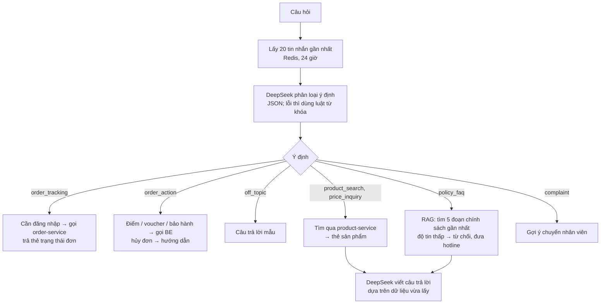

### Chi tiết từng bước

1. **Nhận diện:** người dùng lấy từ `X-User-Id` (gateway gắn nếu có đăng nhập). Chưa đăng nhập vẫn chat được.
2. **Trí nhớ hội thoại:** Redis `chat:{sessionId}:history`, giữ 20 tin gần nhất, sống 24 giờ. Nhờ vậy hỏi "còn màu
   khác không?" bot vẫn hiểu đang nói món nào.
3. **Hiểu ý định (NLU):** gọi DeepSeek ở chế độ trả JSON: `intent` (1 trong 8 loại), `sentiment` (cảm xúc), `order_id`,
   `account_topic`. **DeepSeek lỗi** thì dùng bộ luật từ khóa dự phòng.
4. **Các nhánh không cần LLM** (trả lời bằng dữ liệu thật, nhanh và chắc chắn đúng):
   - **Tra đơn:** chưa đăng nhập → nhắc đăng nhập; chưa có mã đơn → hỏi mã; có thì gọi order-service **bằng chính vé
     của người hỏi**, nên không xem trộm được đơn người khác.
   - **Điểm / voucher / bảo hành:** gọi user-service, promotion-service, order-service tương ứng (cần đăng nhập).
   - **Hủy đơn:** chỉ hướng dẫn cách hủy, **không tự hủy**.
   - **Ngoài lề:** câu trả lời mẫu, kéo về chủ đề mua sắm.
5. **Hỏi sản phẩm:** bỏ từ thừa, gọi tìm kiếm của product-service (5 sản phẩm), có 5 bước nới lỏng nếu không ra kết
   quả. Câu so sánh ("A hay B tốt hơn") được tách thành 2 lần tìm. Lấy thêm thông số chi tiết để LLM có dữ liệu so sánh.
6. **Hỏi chính sách (RAG):**
   - **Chuẩn bị:** 11 tài liệu chính sách được cắt thành 49 đoạn, mỗi đoạn biến thành vector bằng **multilingual-e5-base**,
     lưu FAISS.
   - **Khi hỏi:** câu hỏi → vector → lấy **5 đoạn gần nhất**.
   - **Độ tin cậy:** ≥ 0,82 thì trả lời bình thường; 0,80–0,82 thì trả lời kèm lời nhắc "nên xác nhận lại"; < 0,80 thì
     **từ chối**, đưa số hotline, **không gọi LLM**, để không bịa chính sách.
   - Cuối câu trả lời ghi nguồn "Theo: …".
7. **Viết câu trả lời:** gửi DeepSeek gồm: hướng dẫn hệ thống + dữ liệu vừa lấy + thông tin khách (nếu đăng nhập) +
   tối đa 20 tin nhắn trước + câu hỏi. Chờ tối đa 30 giây; DeepSeek lỗi thì trả lời dự phòng từ dữ liệu đã lấy.
8. **Kết quả trả về:** `{message, intent, products[], card}`. `card` là thẻ đặc biệt: trạng thái đơn, bảo hành, điểm, voucher.
9. **Khiếu nại** → trả `intent: "escalate"` → web gợi ý **chuyển sang nhân viên** (luồng 18). Cảm xúc tiêu cực hiện
   chỉ ghi log.

**Code:** `AI/chatbot-service/app/api/endpoints/chatbot.py`, `app/services/nlu/classifier.py`, `heuristics.py`,
`app/services/rag/product_rag.py`, `policy_rag.py`, `app/services/tools.py`, `memory.py`; `scripts/build_policy_index.py`.

---

## Luồng 18. Chat với nhân viên

### Câu chuyện

> An bấm **"Yêu cầu gặp nhân viên trực tuyến"** trong chatbot. Hệ thống tìm nhân viên **đang online và ít việc nhất**
> là Minh, giao phòng chat cho Minh. Tin nhắn hai bên hiện ngay lập tức. An gửi ảnh chiếc tai nghe bị lỗi, Minh thấy
> ngay. Xong việc, Minh đóng phòng.

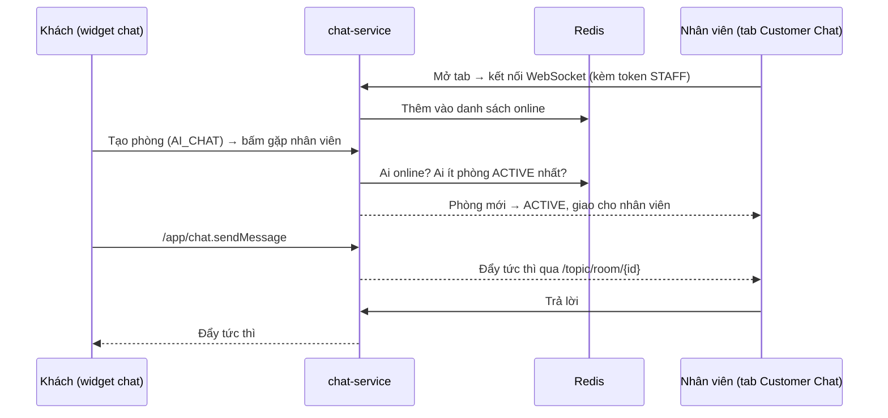

### Chi tiết

1. **WebSocket + STOMP:** WebSocket là **kết nối luôn mở** giữa trình duyệt và server, nên server **chủ động đẩy** tin
   mới xuống, không cần trình duyệt hỏi liên tục. STOMP là "quy ước gửi thư" trên kết nối đó:
   - gửi vào `/app/chat.sendMessage`;
   - nghe ở `/topic/room/{mã phòng}` (tin của phòng) và `/topic/rooms.updates` (danh sách phòng, cho nhân viên).
2. **Kết nối:** gửi kèm token. Có token thì nhận ra là ai và vai trò gì. Khách chưa đăng nhập dùng một mã khách
   (`Guest-Id`) lưu trong localStorage.
3. **Ai đang online:** nhân viên mở tab **Customer Chat** là được thêm vào danh sách Redis `chat:online_staff`; đóng tab
   thì bị xóa.
4. **Phòng chat** (lưu MongoDB, mỗi khách một phòng):
   - **AI_CHAT:** mới tạo, đang nói chuyện với bot.
   - **Bấm gặp nhân viên:** chọn nhân viên online **có ít phòng ACTIVE nhất** → **ACTIVE**. Không ai online →
     **WAITING**; phòng chờ sẽ được giao khi khách nhắn tin tiếp và lúc đó có người online, hoặc nhân viên tự nhận phòng.
   - **CLOSED:** khách hoặc nhân viên đóng; hai bên nhận thông báo hệ thống.
5. **Tin nhắn:** lưu MongoDB (`chatMessages`), cập nhật "tin cuối" của phòng, rồi đẩy cho cả hai bên.
6. **Gửi ảnh:** tải ảnh lên (jpeg/png/gif/webp, ≤ 10MB) → lưu MinIO bucket `chat-images` (tự xóa sau 3 ngày) → gửi
   đường link ảnh như một tin nhắn.
7. **Trang admin** vừa nghe WebSocket vừa hỏi lại danh sách phòng **mỗi 5 giây** để chắc chắn không sót phòng mới.

**Code:** `BE/chat-service/.../WebSocketConfig.java`, `WebSocketEventListener.java`, `ChatRoomServiceImpl.java`,
`ChatMessageServiceImpl.java`, `MinioStorageServiceImpl.java`; `FE/src/features/chatbot/components/AIChatbotWidget.jsx`,
`features/admin/components/SupportChatTab.jsx`.

---

## Phụ lục A. Bảng tin Kafka: ai đăng, ai đọc

| Topic | Ai đăng | Cách đăng | Ai đọc |
|---|---|---|---|
| `order-events` | order-service | Outbox + Debezium | inventory, payment, promotion, notification, forecast (hành vi) |
| `payment-events` | payment-service | Outbox + Debezium | order, promotion, notification |
| `inventory-events` | inventory-service | Trực tiếp | order |
| `user-created-events` | user-service | Trực tiếp | promotion |
| `product-viewed-events` | product-service | Trực tiếp | forecast (hành vi) |
| `cart-updated-events` | order-service | Trực tiếp | forecast (hành vi) |
| `product-reviewed-events` | product-service | Trực tiếp | promotion |
| `user-behavior-events` | forecast-service (nhận từ trình duyệt) | Trực tiếp | forecast (hành vi) |
| `user-risk-events` | forecast-service (quét rủi ro) | Trực tiếp | promotion |
| `notification-events` | chat-service | Trực tiếp | **chưa ai đọc** |

> "Outbox + Debezium" đảm bảo không mất tin; "trực tiếp" đơn giản hơn nhưng có thể mất tin nếu service sập đúng lúc.
> Hệ thống dùng outbox cho hai luồng quan trọng nhất là đơn hàng và thanh toán.

---

## Phụ lục B. Những chỗ code chưa chặt

Phát hiện khi đọc code ngày 2026-10-14. Mục có ✅ đã được đối chiếu trực tiếp; các mục khác là kết quả đọc code, chưa
chạy thử để tái hiện. Dùng cho mục **Hạn chế và hướng phát triển** của báo cáo, hoặc sửa nếu kịp.

| # | Luồng | Vấn đề | Ảnh hưởng |
|---|---|---|---|
| 1 ✅ | Kho | Khi kho **thiếu hàng**, đoạn xử lý lỗi đọc lại tin nhắn mà không giải mã lớp JSON thứ hai như luồng chính → không gửi được tin `FAILED` | Đơn kẹt PENDING đến khi tự hủy sau 30 phút. Ít gặp vì Redis đã chặn thiếu hàng từ lúc đặt |
| 2 | Đặt hàng | Lưu đơn và ghi outbox là **2 lần lưu riêng**, giữa đó còn gọi voucher/điểm | Sập đúng lúc đó thì đơn PENDING không có thư; điểm/voucher đã trừ; 30 phút sau mới tự hủy |
| 3 | Đặt hàng | Xem trước không kiểm tra số dư điểm, còn đặt hàng thì có | Tổng ở trang xem trước có thể khác lúc đặt; đặt hàng thất bại thì đơn bị hủy |
| 4 | Voucher | Voucher % không kiểm tra giá trị đơn tối thiểu | Dùng được cho đơn nhỏ |
| 5 | Voucher | Chuyển RESERVED → USED thất bại thì chỉ ghi log, không thử lại | Voucher kẹt ở "giữ chỗ" |
| 6 | Thanh toán | VNPay thất bại một lần là hủy luôn đơn | Không có "thử thanh toán lại" |
| 7 | Chiến dịch | Điều kiện **Địa chỉ**: giao diện gửi tên tỉnh đầy đủ ("Thành phố Hà Nội"), backend chỉ suy ra "Hanoi" / "Ho Chi Minh" / "Da Nang" | Điều kiện địa chỉ gần như không bao giờ đúng |
| 8 | Chiến dịch | Xóa chiến dịch không gỡ quy trình khỏi Camunda; chiến dịch hẹn giờ không có khách cụ thể | Quy trình hẹn giờ vẫn chạy; hành động phát voucher/cộng điểm bị bỏ qua |
| 9 | Chiến dịch | Thiếu dữ liệu làm giàu (ví dụ không lấy được hạng) thì biểu thức điều kiện lỗi, làm dừng các chiến dịch còn lại của cùng sự kiện | Một chiến dịch lỗi kéo theo chiến dịch khác |
| 10 | Bảo hành | Hạn tính từ **ngày đặt**, không phải ngày giao | Hạn sớm hơn vài ngày |
| 11 | Đánh giá | order-service không trả lời thì product-service **vẫn cho viết** đánh giá | Có thể đánh giá khi chưa mua |
| 12 | Hành vi | Bộ đọc hành vi đánh dấu "đã đọc" kể cả khi xử lý lỗi | Có thể mất một ít sự kiện hành vi |
| 13 | Churn | Thẻ model ghi cửa sổ nhãn 60 ngày, docstring ghi 30 ngày; code thật là **120 ngày** | Dễ trích sai số liệu vào báo cáo: dùng 120 ngày |
| 14 | Churn | "Bỏ giỏ" không có thời gian tối thiểu: vừa thêm giỏ 1 phút đã tính | Có thể tặng voucher hơi sớm |
| 15 | Tìm ảnh | "Độ khớp %" = (cosine + 1) / 2 × 100 | Ảnh không liên quan vẫn hiện khoảng 60% |
| 16 | Chatbot | `docker-compose.yml` của AI không đặt `PRODUCT_SERVICE_URL` | Chạy chatbot trong Docker thì tìm sản phẩm có thể lỗi im lặng (chạy trên máy thì không sao) |
| 17 | Chatbot | Hai lần gọi DeepSeek, mỗi lần chờ tối đa 30 giây, trong khi gateway chỉ chờ chatbot 60 giây | Mạng chậm có thể bị gateway cắt ngang |
| 18 | Chat | Không kiểm tra quyền khi **đăng ký nghe** phòng, không kiểm tra thành viên phòng khi gửi tin | Biết mã phòng là đọc/gửi được vào phòng người khác |
| 19 | Chat | Kết nối WebSocket dùng token lúc mở; token hết hạn sau 15 phút thì kết nối lại sẽ lỗi | Chat lâu có thể mất kết nối |
| 20 | Chat | Không có nhân viên online: tin "khách chờ" gửi lên `notification-events` nhưng không ai đọc | Không có email báo nhân viên |
| 21 | Email | notification-service không có lớp bảo mật riêng, chỉ dựa vào gateway chặn `/api/internal/**` | Nếu mở cổng 8086 ra ngoài thì ai cũng gọi gửi email được |
