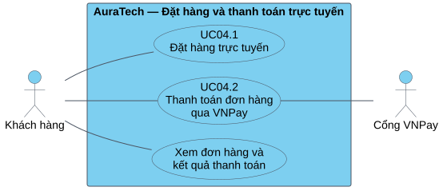

# 2.4. Phân tích và thiết kế phân hệ đặt hàng và thanh toán trực tuyến

## 2.4.1. Bài toán, phạm vi và tác nhân

Phân hệ đặt hàng và thanh toán chuyển nhu cầu mua sắm của khách hàng thành một đơn hàng có thông tin giao nhận, giá trị phải trả và kết quả giao dịch có thể đối soát. Với kiến trúc vi dịch vụ, đơn hàng, tồn kho, ưu đãi, điểm thưởng và thanh toán được quản lý bởi các dịch vụ khác nhau. Một thao tác xác nhận trên giao diện vì vậy cần được phân rã thành nhiều bước có kiểm tra điều kiện, lưu trạng thái và xử lý lỗi.

Phạm vi của phân hệ bắt đầu khi khách hàng mở trang thanh toán với giỏ hàng có sản phẩm, kết thúc ở việc ghi nhận kết quả thanh toán và xác nhận đơn, hoặc hủy đơn và bù trừ khi cần. Trọng tâm là thanh toán trực tuyến VNPay trong môi trường Sandbox. COD được trình bày như nhánh thay thế đã có trong mã nguồn, không mở rộng sang thiết kế nghiệp vụ vận chuyển hay quản lý chiến dịch khuyến mãi của thành viên khác.

Luồng tổng quát gồm: xem trước chi phí; nhập thông tin giao nhận; xác nhận đặt hàng; kiểm tra và giảm số lượng khả dụng trên Redis; lưu đơn hàng và chi tiết; áp dụng ưu đãi/điểm và tính lại giá; ghi sự kiện tạo đơn; khởi tạo thanh toán; chuyển hướng tới VNPay; xác thực phản hồi; cập nhật thanh toán và đơn hàng qua sự kiện; gửi thông báo. Nhánh kho nhận sự kiện tạo đơn để trừ tồn kho vật lý và ghi lịch sử biến động. Nhánh này có thể hoàn tất trước thanh toán, vì vậy không biểu diễn việc trừ kho là một hành động chỉ xảy ra sau khi VNPay báo thành công.

| Tác nhân | Vai trò và ranh giới |
|---|---|
| Khách hàng đã đăng nhập | Xem trước, đặt hàng, chọn VNPay, thực hiện thanh toán, xem kết quả hoặc thanh toán lại trong hạn |
| Cổng VNPay | Hệ thống ngoài nhận yêu cầu thanh toán có chữ ký và gửi tham số kết quả về callback |
| Tiến trình định kỳ | Kích hoạt kiểm tra hết hạn đơn, hết hạn lượt thanh toán và xử lý hoàn tiền chờ |
| Nhân viên/quản trị viên | Tra cứu, xử lý các trường hợp vận hành hoặc hoàn tiền cần can thiệp; chỉ là phần liên quan ngoài luồng mua hàng chính |

`order-service`, `payment-service`, `inventory-service`, Redis và Kafka là các thành phần bên trong hệ thống. Khi vẽ Use Case cho toàn phân hệ, chúng không được coi là tác nhân người dùng. Dịch vụ ưu đãi và người dùng được tham chiếu qua hợp đồng API để kiểm tra voucher và đổi điểm, không phân tích lại toàn bộ hai phân hệ đó.

### Yêu cầu chức năng

| Mã | Yêu cầu |
|---|---|
| FR04-01 | Hiển thị tạm tính, giảm giá sản phẩm, giảm phí vận chuyển, điểm quy đổi, phí giao hàng, VAT tách từ giá và số tiền cuối cùng |
| FR04-02 | Tiếp nhận địa chỉ, điện thoại người nhận, tên người nhận, ghi chú và lựa chọn ưu đãi |
| FR04-03 | Kiểm tra giỏ hàng, trạng thái sản phẩm, giới hạn số lượng và số đơn chưa thanh toán trước khi giữ hàng |
| FR04-04 | Giảm tồn khả dụng bằng Lua trên Redis; khi lỗi giữa chừng phải xử lý phần hàng đã giữ |
| FR04-05 | Lưu ảnh chụp tên sản phẩm, biến thể, đơn giá và số lượng trong chi tiết đơn |
| FR04-06 | Khởi tạo VNPay theo số tiền đọc từ đơn hàng phía server và kiểm tra chủ đơn |
| FR04-07 | Xác minh chữ ký, mã tham chiếu, số tiền và trạng thái trước khi tiếp nhận kết quả |
| FR04-08 | Cho phép xem trạng thái thật, thử thanh toán lại hoặc chọn COD khi còn đủ điều kiện |
| FR04-09 | Xử lý đơn quá hạn, sự kiện trùng, sự kiện đến muộn và trường hợp tiền về sau khi đã hết hạn |
| FR04-10 | Phát thông báo xác nhận thanh toán/đơn hàng theo sự kiện, tách khỏi yêu cầu trình duyệt |

Yêu cầu chất lượng tập trung vào tính đúng đắn của số tiền, không bán vượt số lượng khi xử lý cạnh tranh, giới hạn tác động của thao tác lặp và khả năng theo dõi lỗi. Các yêu cầu này được giải quyết bằng tính giá phía server, Lua, khóa ghi trong cơ sở dữ liệu, khóa khởi tạo thanh toán, Outbox và các bước bù trừ. Việc đã có các cơ chế trong code không tự chứng minh thông lượng hay mức sẵn sàng; các chỉ số hiệu năng cần được đo bằng thực nghiệm riêng.

**Hình 2.4-1. Biểu đồ Use Case phân hệ.**



## 2.4.2. Các quy tắc nghiệp vụ

### Tính giá và giá trị thanh toán

Ký hiệu `S` là tổng `unitPrice × quantity`; `Dsp` là giảm giá sản phẩm từ voucher; `Dship` là phần giảm phí giao hàng; `Dp` là tiền quy đổi từ điểm; `F` là phí giao hàng. Theo `OrderPricingHelper`, các đầu vào tiền được chuẩn hóa không âm. Với các đầu vào hợp lệ:

```text
Giá trị hàng sau voucher G = max(S - Dsp, 0)
F = 0 nếu G >= 500.000 đồng; ngược lại F = 30.000 đồng
Dp = min(số điểm sử dụng × 1.000, max(S - Dsp, 0))
Dship thực tế = min(Dship, F)
Tiền hàng còn lại B = max(S - Dsp - Dp, 0)
VAT hiển thị = làm tròn HALF_UP(B × 0,10 / 1,10) đến đồng
Tổng phải trả T = max(B + F - Dship thực tế, 0)
```

Giỏ trống được quy định phí bằng 0, nhưng Use Case checkout từ chối giỏ trống. Điều kiện miễn phí vận chuyển xét giá trị hàng sau voucher sản phẩm, không trừ tiếp điểm thưởng. Giá niêm yết đã gồm VAT; `vatAmount` chỉ là phần tách ra để trình bày. Không sử dụng công thức `T = B + VAT + F`, vì như vậy thuế bị cộng hai lần. Tỷ lệ 10% ở đây phản ánh hằng số trong mã nguồn, không diễn giải thành quy định thuế chung.

Ví dụ minh họa, không phải số liệu đo hệ thống: `S = 440.000`, `Dsp = 40.000`, sử dụng 10 điểm tương ứng `Dp = 10.000`, `F = 30.000`, voucher hỗ trợ `Dship = 20.000`. Khi đó `B = 390.000`, VAT tách ra là `35.455` và tổng thanh toán là `400.000` đồng. Phép chặn `Dp` ở trên thuộc tính toán preview. Khi đổi điểm thật, user-service kiểm tra số dư và hạn mức theo giá trị được gửi rồi **từ chối** số điểm vượt mức, không tự giảm số điểm khách yêu cầu xuống mức hợp lệ.

Trong `applyPointsToOrder`, giá trị gửi sang user-service được tính bằng `max(totalAmount - productDiscount - shippingDiscount, 0)`, còn preview điểm dùng `max(subtotal - productDiscount, 0)`. Hai đầu vào này có thể khác khi có giảm phí ship. Báo cáo giữ đúng sự khác biệt hiện tại; kết quả đổi điểm thật của user-service mới được đưa vào tính giá chính thức.

Preview mang tính dự kiến. Khi tạo đơn, hệ thống kiểm tra lại voucher, đổi điểm và tính giá; khi khởi tạo thanh toán, payment-service đọc lại `finalAmount` từ order-service. Giá hiển thị phía client, trường `amount` hay phí ship do client gửi không phải căn cứ cuối cùng để thu tiền.

### Giữ hàng, định danh yêu cầu và thời hạn

| Quy tắc | Giá trị/hành vi trong code |
|---|---|
| Số lượng | Tối đa 5 đơn vị cho một mục sản phẩm/biến thể, kèm kiểm tra số lượng hợp lệ ở luồng giỏ |
| Số đơn đang giữ | Kiểm tra tối đa 3 đơn `PENDING`/`AWAITING_PAYMENT` của một khách trước checkout |
| Điện thoại | Chuẩn hóa số Việt Nam dạng 0xxxxxxxxx hoặc +84/84 về dạng bắt đầu bằng 0 |
| Giữ tồn khả dụng | Khóa `product:stock:{productId}:{variantId}`, biến thể không có dùng 0; Lua kiểm tra và giảm trên một khóa |
| Chống checkout trùng | Khóa `checkout:lock:{userId}:{Idempotency-Key}`, TTL 15 phút; kết quả hoàn tất được cache để trả lại |
| Điều kiện kích hoạt | Backend cho phép thiếu `Idempotency-Key`; FE hiện tại có gửi. Hiệu quả chống lặp phụ thuộc tái sử dụng cùng khóa |
| Thời hạn đơn | 30 phút từ thời điểm tạo; scheduler kiểm tra mỗi 5 phút, không bảo đảm giải phóng đúng giây thứ 1.800 |
| COD | Nhánh hỗ trợ với hạn mức mặc định 20.000.000 đồng; payment-service kiểm tra lại |

Tính nguyên tử của Lua chỉ bao phủ một lần kiểm tra–giảm tồn cho một mặt hàng. Với giỏ nhiều mặt hàng, code lặp qua từng mục; nếu mục sau không đủ, cần hoàn phần đã giảm. Kiểm tra số đơn chưa thanh toán cũng không nên được mô tả là một hạn mức nguyên tử toàn hệ thống chỉ vì có lệnh đếm trước checkout.

## 2.4.3. Đặc tả các Use Case chính

### UC04.1 — Xem trước đơn hàng

| Thuộc tính | Đặc tả |
|---|---|
| Tác nhân chính | Khách hàng đã đăng nhập |
| Mục tiêu | Biết các thành phần chi phí trước khi xác nhận |
| Kích hoạt | Mở checkout hoặc thay đổi mã voucher/số điểm |
| Tiền điều kiện | Có giỏ hàng không rỗng; định danh khách hợp lệ |
| Dữ liệu vào | `couponCode`, `pointsToRedeem`; sản phẩm và đơn giá được đọc từ giỏ phía server |
| Hậu điều kiện thành công | Trả `CheckoutPreviewResponse`; chưa tạo đơn, chưa giảm tồn và chưa đổi điểm |
| API | `POST /api/v1/orders/checkout/preview` |

| Bước | Tác nhân/hệ thống thực hiện |
|---|---|
| 1 | Khách hàng mở trang checkout; giao diện gửi yêu cầu preview |
| 2 | OrderController xác định khách và gọi `previewCheckout` |
| 3 | Dịch vụ đọc giỏ; từ chối nếu không có sản phẩm |
| 4 | Nếu có voucher, gọi `promotionClient.previewVoucher` để lấy giảm giá dự kiến và thông báo |
| 5 | Tính phần tiền từ điểm theo yêu cầu; tại preview chưa trừ số dư điểm |
| 6 | `OrderPricingHelper.calculate` tính giá, thuế tách ra và phí vận chuyển |
| 7 | Trả các khoản tiền, `voucherApplied`, thông báo voucher và điều kiện COD để giao diện trình bày |

**Luồng thay thế.** Voucher không áp dụng được có thể được phản ánh bằng `voucherApplied = false` và thông báo; phần giá được tính với mức giảm tương ứng bằng 0. Preview không đảm bảo số dư điểm sẽ đủ tại lúc đặt hàng. Nếu dịch vụ phụ thuộc lỗi, yêu cầu có thể thất bại; FE có giá dự phòng tính cục bộ để hiển thị. Giá dự phòng không thay thế kiểm tra khi đặt hàng.

### UC04.2 — Xác nhận đặt hàng và khởi tạo thanh toán

| Thuộc tính | Đặc tả |
|---|---|
| Tác nhân chính/phụ | Khách hàng; VNPay khi chọn thanh toán trực tuyến |
| Mục tiêu | Tạo đơn hợp lệ và nhận đường dẫn thanh toán |
| Tiền điều kiện | Đăng nhập; giỏ không rỗng; thông tin giao nhận hợp lệ; còn quyền tạo đơn |
| Dữ liệu vào | `CheckoutRequest`, `Idempotency-Key`; tiếp theo là `orderId` và `paymentMethod = VNPAY` |
| Hậu điều kiện thành công | Đơn và chi tiết được lưu, có Outbox tạo đơn, đã giữ tồn khả dụng; Payment `PENDING`, có `txnRef` và URL VNPay |
| API | `POST /api/v1/orders/checkout`, sau đó `POST /api/v1/payments/initiate` |

| Bước | Tác nhân/hệ thống thực hiện |
|---|---|
| 1 | Khách kiểm tra địa chỉ, điện thoại, voucher, điểm và chọn VNPay rồi xác nhận |
| 2 | FE gửi checkout; backend kiểm tra khóa idempotency nếu được cung cấp |
| 3 | Backend đọc giỏ, kiểm tra sản phẩm hoạt động, số lượng, điện thoại và số đơn chưa thanh toán |
| 4 | Với từng sản phẩm/biến thể, khởi tạo cache tồn qua gRPC khi cần và dùng Lua giảm tồn khả dụng |
| 5 | Ghi `Order` trạng thái `PENDING` và các `OrderItem` trong giao dịch cục bộ |
| 6 | Áp dụng voucher/đổi điểm bằng API dịch vụ liên quan, tính giá chính thức và lưu kết quả |
| 7 | Ghi `OrderCreatedEvent` vào Outbox trong giao dịch tiếp theo; xóa giỏ và trả thông tin đơn |
| 8 | FE gọi khởi tạo thanh toán bằng mã đơn; payment-service khóa khởi tạo theo đơn |
| 9 | Đọc tóm tắt đơn từ order-service, kiểm tra chủ đơn, trạng thái, hạn trả và số tiền |
| 10 | Tạo hoặc tái sử dụng Payment trong giao dịch ngắn, sinh `txnRef`, ký URL và trả `redirectUrl` |
| 11 | FE chuyển trình duyệt sang VNPay để khách thực hiện giao dịch |
| Song song | Outbox được chuyển tiếp qua CDC/Kafka; inventory-service xử lý tạo đơn, trừ kho vật lý và phản hồi trạng thái kho |

**Ngoại lệ và luồng thay thế.**

- Cùng khóa checkout đang xử lý: trả lỗi yêu cầu trùng; nếu đã có kết quả cache thì trả lại kết quả, không tạo đơn mới.
- Mục hàng không đủ tồn: dừng checkout; nếu giao dịch lưu đơn đầu tiên chưa commit, hoàn lại các mục đã giữ trên Redis.
- Voucher/điểm hoặc bước sau khi lưu đơn lỗi: hủy/bù trừ; nếu đã commit đơn, ưu tiên sự kiện hủy để luồng kho xử lý hoàn, tránh vừa hoàn trực tiếp vừa hoàn theo sự kiện.
- Checkout thành công nhưng khởi tạo thanh toán lỗi: đơn đã tồn tại; khách tiếp tục từ chi tiết đơn, không mặc định tạo lại đơn mới. Giỏ có thể đã được xóa.
- COD: không chuyển sang cổng, phát `PaymentCODConfirmedEvent`; Payment vẫn `PENDING` đến khi giao hàng. Đây là nhánh khác với nhận tiền thành công qua VNPay.

Không gọi bước 5–7 là một giao dịch duy nhất: `createOrder` chủ động chia giao dịch lưu đơn, gọi dịch vụ ngoài và ghi sự kiện thành các đoạn khác nhau. Các bước bù trừ là một phần thiết kế cần giải thích.

### UC04.3 — Tiếp nhận và xác thực kết quả VNPay

| Thuộc tính | Đặc tả |
|---|---|
| Tác nhân khởi phát | VNPay; trình duyệt quay về cũng gọi đường callback hiện tại |
| Mục tiêu | Ghi nhận đúng kết quả giao dịch và đồng bộ trạng thái nghiệp vụ |
| Tiền điều kiện | Có thông tin giao dịch để tra cứu; callback chỉ được nhận là hợp lệ sau kiểm tra chữ ký và số tiền |
| Dữ liệu vào | Các tham số `vnp_*`, gồm `vnp_TxnRef`, `vnp_Amount`, `vnp_ResponseCode`, `vnp_SecureHash` |
| Hậu điều kiện thành công | Payment `SUCCESS`, có thời điểm trả và Outbox `PaymentSuccessEvent`; đơn được cập nhật bất đồng bộ nếu chuyển trạng thái hợp lệ |
| API | `GET /api/v1/public/payments/vnpay-callback` |

| Bước | Tác nhân/hệ thống thực hiện |
|---|---|
| 1 | VNPay gửi kết quả; WebhookController chuyển tham số cho `verifyVnPayCallback` |
| 2 | Dịch vụ lọc/sắp xếp tham số, loại trường chữ ký, mã hóa lại giá trị và tính HMAC-SHA512 |
| 3 | So sánh chữ ký; tra Payment theo `txnRef` với khóa ghi, hoặc kiểm tra mã lượt cũ đã thay |
| 4 | Đối chiếu số tiền callback với `Payment.amount × 100` |
| 5 | Với lượt hiện tại còn `PENDING` và `vnp_ResponseCode = 00`, cập nhật `SUCCESS`, `paidAt`, mã cổng và nội dung phản hồi |
| 6 | Ghi WebhookLog và `PaymentSuccessEvent` vào Outbox trong giao dịch xử lý callback |
| 7 | Sau commit, sự kiện được chuyển tới Kafka; order-service nhận và chuyển đơn sang `CONFIRMED` nếu hợp lệ |
| 8 | Order-service ghi `OrderConfirmedEvent`; notification-service xử lý email xác nhận đơn. Sự kiện thanh toán có thông báo thanh toán riêng |
| 9 | IPN nhận JSON phản hồi. Với trình duyệt, controller chuyển hướng về chi tiết đơn; FE đọc trạng thái thanh toán từ API có xác thực |

**Các kết quả khác.**

| Điều kiện | Xử lý hiện tại |
|---|---|
| Chữ ký thiếu/sai | Ghi log không hợp lệ; trả `97`; không công nhận thanh toán |
| Không tìm thấy giao dịch | Trả `01` |
| Số tiền thiếu, sai định dạng hoặc không khớp | Trả `04` |
| Callback của lượt đã xử lý | Thường trả `02`; không phát lại sự kiện thành công của lượt hiện tại |
| VNPay từ chối/khách hủy giao dịch | Payment `FAILED`; phát thất bại loại `GATEWAY_DECLINED`; đơn tiếp tục chờ để thử lại |
| Callback thành công cho Payment `FAILED`/`EXPIRED` | Chuyển `REFUND_PENDING`, tạo Refund chờ thay vì tự coi đơn đã được phục hồi |
| Callback của mã VNPay cũ đã bị thay | Nhánh riêng: có thể nhận lượt cũ nếu bản ghi hiện tại còn chờ, hoặc tạo yêu cầu hoàn thủ công khi đã thanh toán bằng lượt khác |

`RspCode = 00` là mã tiếp nhận callback, có thể được trả cả khi giao dịch VNPay thất bại nhưng đã xử lý thông báo. Không dùng riêng mã này để hiển thị “đã trả tiền”. Trong nhánh callback chính hiện tại, quyết định thành công dựa vào chữ ký, số tiền và `vnp_ResponseCode`; không mô tả thêm kiểm tra `vnp_TransactionStatus` như một bước đã được cài trong nhánh đó.

## 2.4.4. Mô hình lớp phân tích

Ở mức phân tích, mô hình thể hiện các khái niệm nghiệp vụ và trách nhiệm, chưa gắn với framework. `GiaoDienThanhToan` và `GiaoDienKetQua` là lớp biên; `DieuPhoiDatHang`, `TinhGiaDonHang`, `XuLyThanhToan` và `XuLyKho` là lớp điều khiển; `GioHang`, `DonHang`, `ChiTietDonHang`, `GiaoDichThanhToan`, `TonKho` và `BienDongKho` là các thực thể. Khách hàng gắn với giỏ hàng và đơn hàng qua định danh; chi tiết đơn lưu ảnh chụp thông tin hàng hóa lúc mua.

Một đơn đã lưu có một hoặc nhiều chi tiết; tại thời điểm vừa tạo có thể chưa có Payment. Mã nguồn tổ chức tái sử dụng một Payment chính cho một đơn khi thanh toán lại, thay mã tham chiếu và thời điểm lượt. Bội số `0..1` trong mô hình nghiệp vụ vì vậy diễn tả ý định của dịch vụ; không phải khẳng định cơ sở dữ liệu đã có unique constraint trên `payments.order_id`. Một Payment có thể có nhiều yêu cầu hoàn tiền. Lịch sử kho liên hệ đơn bằng mã đơn để kiểm tra xử lý lặp và hoàn lại lượng đã trừ.

**Hình 2.4-2. Biểu đồ lớp phân tích.**


## 2.4.5. Thiết kế lớp và phân chia trách nhiệm

**Hình 2.4-3. Biểu đồ lớp thiết kế, lược bỏ thành phần ngoài phạm vi.**


Tầng giao diện React dùng `CheckoutPage` để lấy preview, nhận dữ liệu giao nhận và khởi tạo chuỗi checkout–thanh toán. `orderApi.ts` đóng gói các API và gửi khóa idempotency. Sau khi tạo đơn, FE gọi payment-service riêng và điều hướng theo `redirectUrl`, vì vậy tạo đơn thành công và khởi tạo thanh toán thành công là hai kết quả khác nhau.

Trong order-service, `OrderController` tiếp nhận yêu cầu và chuyển định danh đã xác thực tới `OrderService`. `OrderServiceImpl` điều phối giỏ hàng, tồn khả dụng, voucher, điểm và lưu đơn. `OrderPricingHelper` tập trung phép tính tiền; `ShippingFeeCalculator` quyết định phí giao hàng; `OrderStatusMachine` giới hạn các chuyển trạng thái. `OrderRepository`, `OrderItemRepository` và `OutboxEventRepository` phục vụ lưu trữ. Gọi mạng được tách khỏi nhiều đoạn giao dịch ngắn nhằm tránh giữ kết nối cơ sở dữ liệu khi chờ dịch vụ khác.

Trong payment-service, `PaymentController` tiếp nhận khởi tạo/thanh toán lại và đọc trạng thái; `WebhookController` nhận phản hồi cổng. `PaymentServiceImpl` kiểm tra đơn, quản lý lượt thanh toán, dựng URL ký số, xác minh callback và tạo yêu cầu hoàn. `PaymentRepository.findByTxnRefWithLock` tuần tự hóa các cập nhật cạnh tranh trên giao dịch tìm được. Khóa Redis khi khởi tạo theo đơn bổ sung kiểm soát trước khi có bản ghi Payment.

Trong inventory-service, `InventoryKafkaConsumer` nhận sự kiện, dùng khóa theo đơn trong quá trình xử lý và chuyển cho `InventoryDeductService`. Dịch vụ kho sắp xếp mặt hàng theo sản phẩm/biến thể rồi khóa ghi từng dòng tồn, giảm số lượng và lưu `InventoryTransaction` trong giao dịch. Thông báo kết quả kho được phát sau commit. Sơ đồ thiết kế dùng các tên lớp có thật; các thành phần hạ tầng như broker/CDC không được giả lập thành lớp nghiệp vụ Java.

### Trạng thái và giao tiếp

| Đối tượng | Trạng thái/ý nghĩa trong phạm vi |
|---|---|
| Order `PENDING` | Vừa lưu, có thể đang chờ xử lý kho và thanh toán |
| Order `AWAITING_PAYMENT` | Đã nhận thông báo trừ kho thành công, chờ trả tiền |
| Order `CONFIRMED` | Nhận thanh toán thành công hoặc xác nhận COD |
| Order `CANCELLED` | Đã hủy trước giao vận; các dịch vụ thực hiện bù trừ |
| Payment `PENDING` | Lượt hiện tại chưa được kết luận đã trả tiền |
| Payment `SUCCESS` | Đã ghi nhận thanh toán thành công |
| Payment `FAILED`/`EXPIRED` | Lượt bị từ chối hoặc hết hạn; khác với trạng thái hủy đơn |
| Payment `REFUND_PENDING` | Có khoản tiền cần hoàn do điều kiện bất thường/hủy phù hợp |

Máy trạng thái cho phép `PENDING → CONFIRMED` và `AWAITING_PAYMENT → CONFIRMED`. Do sự kiện kho và thanh toán khác topic, không áp đặt một thứ tự đến duy nhất: nếu thanh toán xác nhận trước, sự kiện kho đến sau không được làm đơn lùi về `AWAITING_PAYMENT`. Các trạng thái giao hàng và hoàn hàng tiếp theo thuộc phạm vi tích hợp, được giữ nguyên trong code nhưng không phải luồng chính của phần này.

| Giao tiếp | Hình thức và dữ liệu |
|---|---|
| FE → order/payment | REST có xác thực; các API checkout, initiate, status và retry |
| Order → inventory | gRPC lấy tồn khi cache chưa được khởi tạo |
| Order → promotion/user | API kiểm tra/áp dụng voucher và đổi/hoàn điểm |
| Order → các consumer | `order-events`: tạo đơn, xác nhận đơn, hủy đơn |
| Inventory → Order | `inventory-events`: kết quả trừ kho |
| Payment → Order/Notification | `payment-events`: thành công, thất bại, xác nhận COD |
| Payment ↔ VNPay | URL ký số, callback và tra soát/hoàn tiền khi cần |

**Hình 2.4-4. Hoạt động xem trước và tạo đơn.**


**Hình 2.4-5. Hoạt động tiếp nhận kết quả thanh toán.**


## 2.4.6. Thiết kế tương tác và nhất quán dữ liệu

**Hình 2.4-6. Trình tự tạo đơn, nhánh kho và khởi tạo VNPay.**


Trình tự tạo đơn có hai ranh giới quan trọng. Thứ nhất, preview không giữ hàng; kiểm tra tại lúc tạo đơn mới quyết định có chấp nhận được yêu cầu hay không. Thứ hai, việc trả response cho FE không đồng nghĩa mọi consumer đã hoàn tất. Sau khi sự kiện được phát, kho có thể đang xử lý trong lúc khách đã được chuyển tới cổng thanh toán. Sơ đồ dùng khối song song để thể hiện hai nhánh; nó không khẳng định mọi sự kiện luôn đến theo thứ tự nét vẽ.

**Hình 2.4-7. Trình tự callback, chống lặp và xác nhận đơn.**


Giao dịch callback cập nhật Payment cùng bản ghi Outbox. Sau commit, CDC chuyển sự kiện tới Kafka để order-service cập nhật trạng thái trong giao dịch của nó và ghi Outbox xác nhận đơn. Việc gửi email nằm ở notification-service, nên không gắn thành công thanh toán với việc SMTP đã gửi xong. Notification-service xử lý cả `PaymentSuccessEvent` và `OrderConfirmedEvent` với mẫu khác nhau; báo cáo phân biệt email xác nhận thanh toán và email xác nhận đơn.

Không tồn tại một transaction ACID bao trùm Redis, các cơ sở dữ liệu dịch vụ, Kafka và VNPay. Hệ thống sử dụng các giao dịch cục bộ, sự kiện và bù trừ. Đặc biệt, code tạo đơn lưu đơn trước rồi mới ghi sự kiện tạo đơn sau khi xử lý voucher/điểm; do đó cần các nhánh xử lý lỗi sau commit. Outbox cải thiện độ tin cậy ở các điểm đã áp dụng, không làm mọi tác động bên ngoài tự động nguyên tử.

Kết quả kho được gửi Kafka sau commit bằng producer trực tiếp. Nhánh này không có Outbox kho trong đoạn mã đã đối chiếu; nếu tiến trình dừng ở khoảng giữa commit và gửi sự kiện, cần cơ chế xử lý lại/đối soát để kết luận hội tụ. Tương tự, các đoạn `afterCommit` cập nhật Redis hoặc gọi dịch vụ khác không tự trở thành một giao dịch cùng database. Đây là giới hạn của hiện thực cần phân biệt với mục tiêu thiết kế.

## 2.4.7. Thiết kế dữ liệu phân hệ

**Hình 2.4-8. Mô hình dữ liệu theo quyền sở hữu dịch vụ.**


Các bảng được suy ra từ entity JPA hiện tại. Hình dùng đường liền cho tham chiếu mã trong cùng dịch vụ, đường đứt cho tham chiếu logic giữa các dịch vụ; cách vẽ không khẳng định có khóa ngoại vật lý. Không bổ sung bảng reservation, bảng hóa đơn thuế hay bảng payment-attempt độc lập khi chúng chưa có trong code. Sơ đồ là mô hình dữ liệu chọn lọc trong phạm vi đặt hàng/thanh toán, không phải bản dump schema production.

### Nhóm dữ liệu order-service

| Bảng/trường chính | Kiểu và vai trò |
|---|---|
| `orders.id` | `Long`, khóa chính sinh tự động |
| `user_id`, `email`, `status` | Định danh chủ đơn, địa chỉ nhận thông báo, trạng thái đơn |
| `total_amount`, `discount_amount`, `final_amount` | `BigDecimal`, cột tiền `DECIMAL(15,2)`; `discount_amount` lưu tổng giảm giá sản phẩm, phí ship và điểm do `applyPricingToOrder` gán |
| `point_discount_amount`, `points_redeemed` | Tiền giảm từ điểm và số điểm được ghi nhận |
| `shipping_fee`, `shipping_discount_amount`, `vat_amount` | Phí giao hàng, giảm phí và VAT đã tách từ giá |
| `coupon_code`, `applied_campaign_id` | Dấu vết voucher/chiến dịch liên quan |
| `shipping_address`, `phone_number`, `recipient_name`, `recipient_phone` | Ảnh chụp thông tin nhận hàng; địa chỉ và điện thoại bắt buộc theo entity/request |
| `cancel_reason_code`, `cancel_reason`, `cancelled_by`, `cancelled_at` | Dấu vết hủy đơn |
| `created_at`, `updated_at` | Mốc tạo/cập nhật; `paymentDeadline` trong response được suy ra, không phải cột entity |
| `order_items.id`, `order_id` | Khóa chi tiết và mã đơn sở hữu; một đơn được tạo có ít nhất một chi tiết |
| `product_id`, `variant_id`, `product_name`, `variant_attr` | Tham chiếu hàng hóa và ảnh chụp mô tả tại thời điểm đặt |
| `unit_price`, `quantity`, `subtotal` | Giá, số lượng và thành tiền từng dòng; tiền `DECIMAL(15,2)` |
| `outbox_events` | `aggregate_id`, `aggregate_type`, `event_type`, `payload`, trạng thái và thông tin retry; bản ghi sự kiện order |

Tên sản phẩm và đơn giá được giữ lại ở chi tiết giúp tra cứu đơn cũ mà không phụ thuộc hoàn toàn vào thông tin danh mục đang thay đổi. Quan hệ Order–OrderItem được thực hiện bằng trường mã và repository; entity không khai báo tập `@OneToMany`. Khi triển khai cơ sở dữ liệu thực tế phải kiểm tra schema riêng trước khi khẳng định có FK hay index ngoài các khai báo đã đọc.

### Nhóm dữ liệu payment-service

| Bảng/trường chính | Kiểu và vai trò |
|---|---|
| `payments.id`, `order_id`, `user_id` | Khóa thanh toán, mã đơn tham chiếu logic và chủ sở hữu |
| `txn_ref` | Chuỗi duy nhất, bắt buộc; mã lượt VNPay hiện tại |
| `previous_txn_refs` | Các mã lượt cũ phân tách bằng dấu phẩy; không phải bảng lịch sử lượt riêng |
| `gateway_txn_id`, `payment_method` | Mã giao dịch cổng và phương thức `VNPAY`/`COD` |
| `amount`, `currency` | Tiền `DECIMAL(19,2)`, mặc định VND |
| `status`, `failure_code`, `gateway_response` | Kết quả, nguyên nhân và payload phục vụ truy vết |
| `paid_at`, `attempt_at`, `created_at`, `updated_at` | Thời điểm trả, lượt gần nhất, tạo và cập nhật; timeout lượt dựa `attemptAt`, dữ liệu cũ dùng `createdAt` |
| `webhook_logs` | `gateway`, `raw_payload`, `signature_valid`, `processed`, `created_at` |
| `refunds` | `payment_id`, `refund_amount`, `reason`, `status`, mã hoàn phía cổng và mốc hoàn tất |
| `outbox_events` | Bản ghi sự kiện payment; có cờ `published`, cấu trúc khác Outbox của order |

Payment được tái sử dụng theo `orderId` trong nghiệp vụ. Entity chỉ khai báo duy nhất cho `txn_ref`, chưa khai báo unique cho `order_id`, nên ERD không ghi `order_id` là unique. `WebhookLog` không có cột `payment_id` hoặc `order_id`; liên hệ một log với thanh toán phải tra cứu mã trong payload. Vì vậy không vẽ khóa ngoại Payment–WebhookLog như một cấu trúc đã tồn tại. Refund là quan hệ một-nhiều theo ý nghĩa nghiệp vụ và trường `paymentId`; không giới hạn giả tạo một lần hoàn cho mỗi Payment.

### Nhóm dữ liệu inventory-service và Redis

| Dữ liệu | Kiểu và vai trò |
|---|---|
| `inventories` | `id`, `product_id`, `variant_id`, `quantity`, `updated_at`; có unique constraint cặp sản phẩm–biến thể |
| `inventory_transactions` | Mã đơn, sản phẩm/biến thể, loại biến động, số thay đổi, số trước/sau, tham chiếu, ghi chú và thời điểm |
| `DEDUCT` | Lịch sử trừ kho vật lý cho đơn |
| `RELEASE` | Lịch sử trả lại lượng đã trừ khi hủy |
| `CANCEL_RECEIVED` | Dấu hủy đã nhận trước sự kiện tạo, dùng ngăn xử lý trừ kho đến muộn; bản ghi đánh dấu có mã sản phẩm 0 |
| `cart:{userId}` | Dữ liệu giỏ hàng Redis do order-service đọc |
| `product:stock:{productId}:{variantId}` | Tồn khả dụng phục vụ kiểm tra/giữ hàng sớm |
| `checkout:lock:{userId}:{key}` | Trạng thái xử lý hoặc JSON response checkout, TTL 15 phút |
| `payment:initiate:lock:{orderId}` | Khóa ngắn để tuần tự hóa khởi tạo thanh toán theo đơn |

Không có một reservation có TTL riêng cho từng đơn trong mô hình này. Không thể nói “hết TTL Redis là hàng tự trả”; việc trả hàng phụ thuộc luồng hủy, consumer kho và bù trừ. Khi đã có lịch sử trừ kho, hệ thống hoàn database trước và cộng Redis tương đối sau commit, tránh ghi đè số tuyệt đối lên các lượt checkout đang diễn ra.

## 2.4.8. Xử lý lỗi đặc trưng và căn cứ đánh giá

### Tình huống 1 — Hai callback thành công cho cùng một lượt

VNPay có thể gửi lại callback khi không nhận được phản hồi; trình duyệt và IPN cũng có thể cùng gọi endpoint. Nếu cả hai lần cùng chuyển trạng thái và phát sự kiện, hệ thống có nguy cơ thông báo lặp và áp dụng tác động nghiệp vụ nhiều lần.

Với một Payment ban đầu `PENDING`, yêu cầu đầu xác thực chữ ký/số tiền rồi khóa dòng theo `txnRef`, cập nhật `SUCCESS` và ghi Outbox trong cùng transaction. Yêu cầu thứ hai chờ khóa; khi đọc lại thấy trạng thái không còn `PENDING`, nhánh thông thường trả `02` thay vì phát thêm `PaymentSuccessEvent`. Order-service kiểm tra trạng thái chuyển trước khi xác nhận; consumer thông báo có kiểm tra theo `(orderId, eventType)` để giảm việc gửi lặp. Không suy diễn thành bảo đảm exactly-once cho mọi hệ thống phụ thuộc từ riêng các bước kiểm tra này.

Tiêu chí kiểm chứng là có một Payment thành công, một sự kiện thành công được tạo bởi nhánh callback chính, trạng thái đơn không lùi và không phát sinh lần trừ kho mới do callback. Việc trừ kho thuộc sự kiện tạo đơn, không thuộc hàm callback.

### Tình huống 2 — Khách hủy trên VNPay rồi thanh toán lại

Khi cổng trả mã không thành công, Payment chuyển `FAILED`, nhưng `PaymentFailedEvent` có `failureType = GATEWAY_DECLINED` được order-service tiếp nhận mà không hủy đơn. Khách có thể gọi retry khi đơn còn `PENDING`/`AWAITING_PAYMENT` và chưa quá hạn; dịch vụ dùng lại Payment, thay `txnRef`, cập nhật `attemptAt` và giữ mã cũ để đối soát callback đến muộn. Nếu đổi COD phải kiểm tra hạn mức và trạng thái lượt VNPay trước.

Điểm cần quan sát là đơn chưa bị hủy chỉ vì một lượt giao dịch thất bại, số tiền retry vẫn lấy từ server và không tạo thêm đơn hàng. Khóa ngăn khởi tạo đồng thời không thay thế việc giữ lại cùng khóa checkout khi client gửi lại yêu cầu tạo đơn.

### Tình huống 3 — Hết hạn đơn và sự kiện hủy đến trước tạo

Scheduler quét các đơn chưa thanh toán sau 30 phút và gọi `expireOrder`. Luồng hủy ghi trạng thái cùng sự kiện hủy rồi phối hợp trả voucher, điểm và kho. Nếu kho đã có giao dịch `DEDUCT`, dịch vụ trả đúng lượng dựa lịch sử và ghi `RELEASE`. Nếu chưa có lịch sử trừ, nó ghi `CANCEL_RECEIVED`; thao tác cộng lại Redis được đăng ký sau commit. Sự kiện tạo đến sau thấy dấu hủy thì không tiếp tục trừ kho.

Trường hợp này cho thấy cần phân biệt ba thời điểm: giữ số lượng Redis, commit trừ MySQL và nhận tín hiệu hủy. Chỉ mô tả “thất bại thì cộng kho” là chưa đủ, vì có thể cộng hai lần hoặc trừ sau khi đã hủy. Kịch bản cần bao gồm cả phát lại sự kiện hủy, để kiểm tra dấu đánh dấu/nhật ký đã ngăn hoàn lặp trong luồng đang xét.

### Tình huống 4 — Tiền về sau khi lượt đã hết hạn

Nếu callback hợp lệ báo thành công trong khi Payment đã `EXPIRED` hoặc `FAILED`, nhánh hiện tại tạo Refund chờ và chuyển Payment `REFUND_PENDING`, không đơn giản biến lại thành một đơn mua thành công. Scheduler hoàn tiền chạy định kỳ để xử lý các yêu cầu chờ; trường hợp cần can thiệp có trạng thái riêng. Khi sự kiện thanh toán và hủy đơn cạnh tranh, phải đối soát cả Order lẫn Payment vì chúng nằm ở hai database và không commit chung.

### Căn cứ kiểm thử và giới hạn kết luận

Các nhóm test sẵn có gồm `OrderPricingHelperTest`, `OrderServiceImplTest`, `PaymentServiceImplTest`, `InventoryDeductServiceTest`, các consumer test và bộ test case thủ công trong `docs/test`. Chúng là nguồn để tổ chức kiểm chứng, không phải bằng chứng rằng toàn bộ đã chạy đạt trên môi trường hiện tại.

| Kịch bản kiểm chứng | Bất biến/kết quả cần quan sát |
|---|---|
| Preview có voucher + điểm + freeship | Tổng tiền theo công thức, phí giảm không vượt phí thực, không cộng VAT lần hai |
| Hai yêu cầu giữ cùng mặt hàng | Số Redis không âm do check–decrement cùng một script; kiểm tra thêm DB sau consumer |
| Hết tồn ở mục thứ hai | Phần mục thứ nhất được bù trừ phù hợp ranh giới commit |
| Giả mạo amount phía FE | Khởi tạo VNPay vẫn dùng `finalAmount` đọc từ đơn |
| Callback sai chữ ký/số tiền | Không cập nhật Payment thành công, có log và mã từ chối phù hợp |
| Callback thành công lặp | Nhánh callback chính không tạo thêm sự kiện thành công |
| Thất bại một lượt rồi retry | Không tạo đơn mới; lượt mới có mã tham chiếu mới và giá đúng |
| Đơn hết hạn, tạo/hủy đến đảo thứ tự | Không trừ sau dấu hủy, không hoàn Redis hai lần trong luồng đã xử lý |
| Thành công muộn khi đã hết hạn | Có yêu cầu hoàn hoặc xử lý đối soát phù hợp; không báo thành công chỉ từ URL |
| Kafka/SMTP tạm lỗi | Kiểm tra retry/log/trạng thái thực tế; không khẳng định email đã tới hộp thư chỉ từ Payment SUCCESS |

Đối với các yêu cầu an toàn như giữ toàn giỏ, khóa quá TTL, mất tiến trình giữa database và sự kiện, cần kiểm thử lỗi tích hợp thay vì chỉ dựa vào unit test. Báo cáo không đưa số RPS, độ trễ, tỷ lệ thành công hoặc khẳng định đã thanh toán thật khi chưa có dữ liệu thực nghiệm. Danh sách phương thức và đường dẫn làm căn cứ được trình bày trong [bảng đối chiếu mã nguồn](DOI_CHIEU_MA_NGUON.md).

## 2.4.9. Kết luận phần phân hệ

Thiết kế tổ chức đặt hàng và thanh toán thành chuỗi bước có trạng thái, với tính giá phía server, giữ số lượng khả dụng trên Redis, lưu đơn và lịch sử kho, xác thực callback VNPay, truyền sự kiện và bù trừ. Phân tách trách nhiệm giúp biểu diễn rõ đâu là xác nhận đã nhận tiền, đâu là xác nhận đơn và đâu là kết quả xử lý kho. Các sơ đồ và đặc tả phản ánh hiện thực mã nguồn, đồng thời giữ rõ ranh giới giữa cơ chế đã cài và các bảo đảm cần được kiểm thử thêm.
