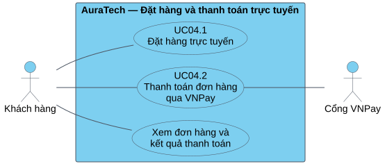
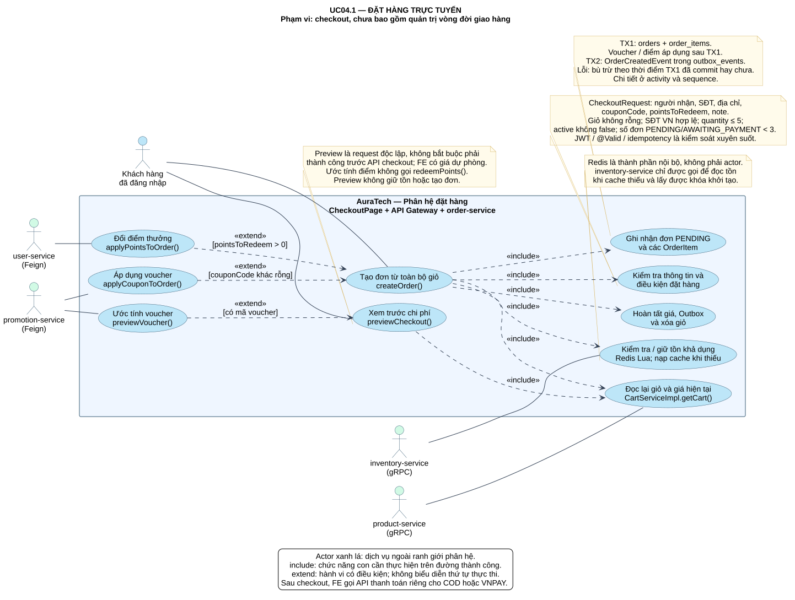
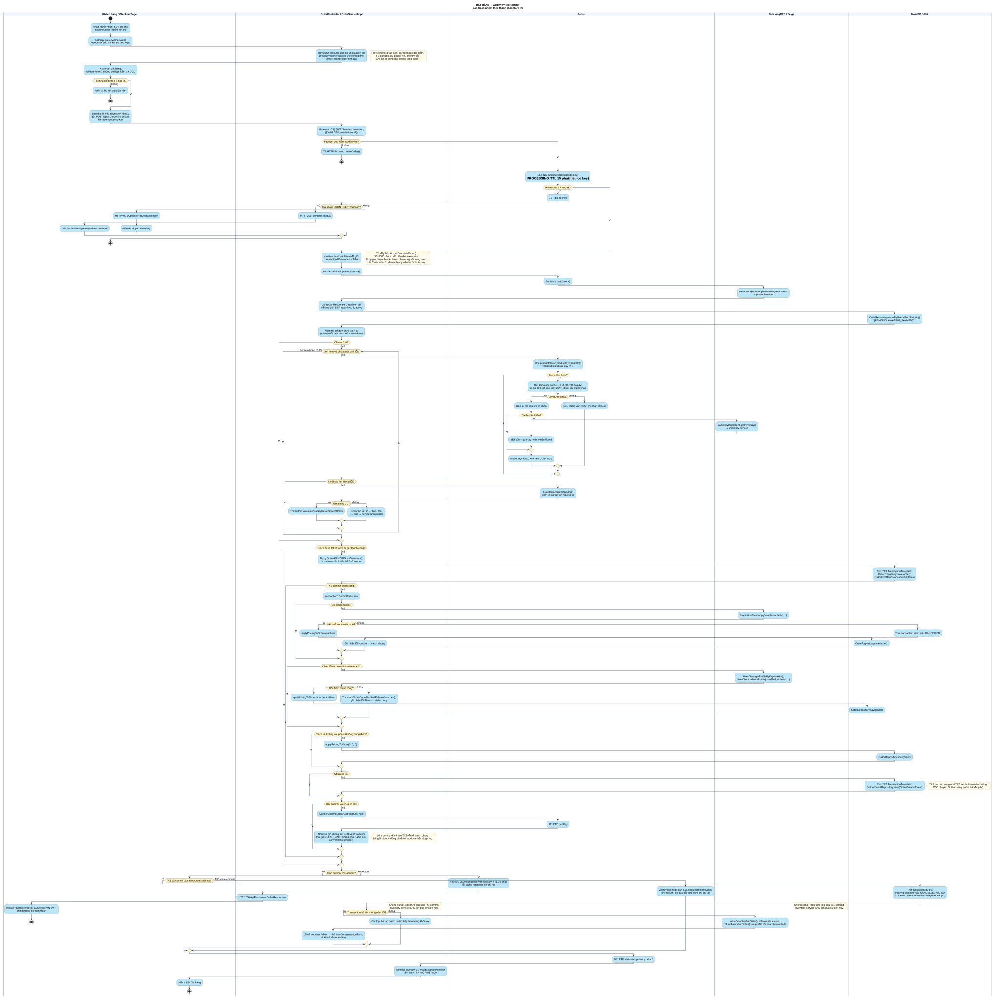
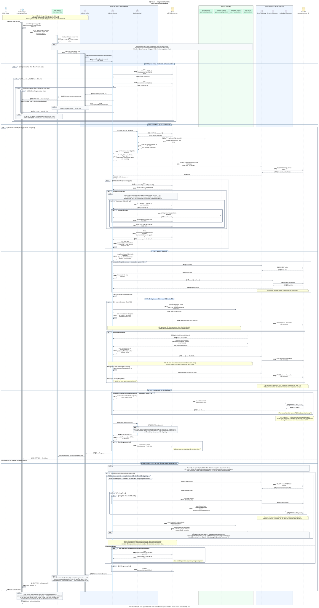
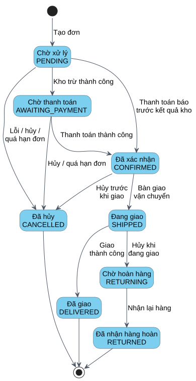
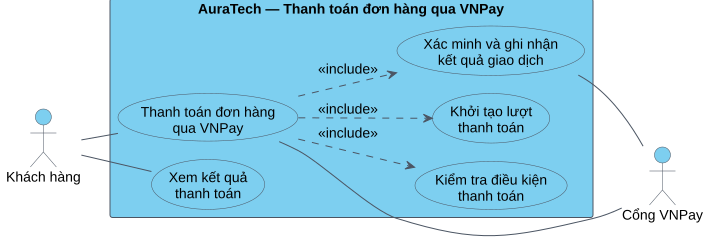
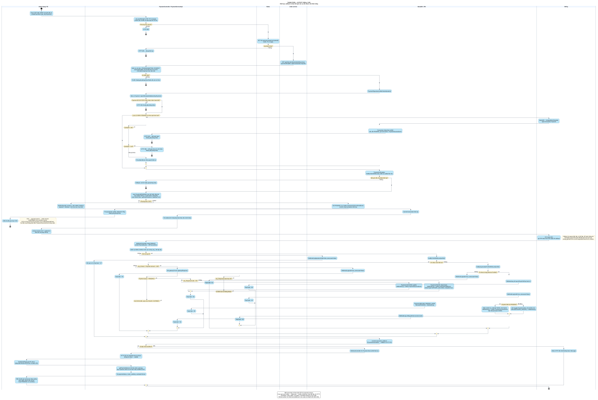
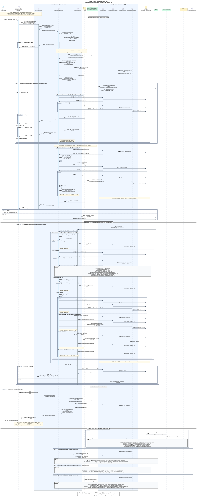
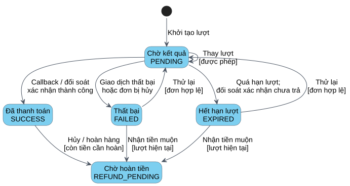

# Sơ đồ phân tích cho module đặt hàng và thanh toán

Bộ hình gồm hai UC chính, mỗi UC có Use Case, Activity, Sequence và trạng thái. Hình thức tham khảo ảnh mẫu người dùng cung cấp: khung và nút xanh nhạt, nền trắng, đường viền tối; Activity có làn trách nhiệm; Sequence có biểu tượng actor/boundary/control/entity và thanh kích hoạt. Nội dung nghiệp vụ được đối chiếu với source AuraTech, không lấy nội dung tuyển dụng/CV của mẫu.

Mỗi mục trình bày theo thứ tự **mô tả → hình → chú thích**, riêng Use Case có bảng đặc tả. Mã TQ, DH-1…DH-4, TT-1…TT-4 là mã tạm, cần đổi theo mục lục hình của báo cáo chung.

## Use Case tổng quát

Phân hệ cho phép khách tạo đơn từ giỏ hàng, thanh toán đơn đã có qua VNPay và xem lại kết quả. Hai UC chính được tách vì một đơn có thể được thanh toán lại mà không cần tạo đơn mới.

**Hình TQ.** *Sơ đồ Use Case tổng quát phân hệ đặt hàng và thanh toán trực tuyến.*

[SVG](diagrams/01-use-case.svg) · [PNG](diagrams/01-use-case.png) · [PlantUML](diagrams/01-use-case.puml) · [Phạm vi hai UC](UC_TONG_QUAT.md)

## UC04.1 — Đặt hàng trực tuyến

### a) Sơ đồ Use Case

Use Case mô tả việc khách xem các khoản chi phí, cung cấp thông tin nhận hàng và xác nhận đặt hàng. Hệ thống kiểm tra khả năng đáp ứng trước khi ghi nhận đơn. Áp dụng mã giảm giá và sử dụng điểm thưởng là các lựa chọn tại bước xem trước; khi tạo đơn thật, backend kiểm tra và áp dụng lại.

**Hình DH-1.** *Sơ đồ Use Case: Đặt hàng trực tuyến.*

[SVG](diagrams/dat-hang/01-use-case.svg) · [PNG](diagrams/dat-hang/01-use-case.png) · [PlantUML](diagrams/dat-hang/01-use-case.puml)

**Bảng DH-1.** *Đặc tả Use Case: Đặt hàng trực tuyến.*

| Thành phần | Nội dung |
|---|---|
| Tên Use Case | Đặt hàng trực tuyến — UC04.1 |
| Actor | Khách hàng |
| Tiền điều kiện | Khách đã đăng nhập; giỏ hàng có sản phẩm. |
| Hậu điều kiện thành công | Đơn và chi tiết được lưu; số tiền chính thức được ghi nhận; sự kiện tạo đơn có trong outbox; giỏ được xóa; khách nhận mã đơn. Kho được xử lý qua sự kiện, không phải điều kiện chờ trước khi trả mã đơn. |
| Kịch bản chính | 1. Khách mở checkout. 2. Hệ thống hiển thị bảng xem trước. 3. Khách nhập giao nhận và chọn ưu đãi nếu có. 4. Khách xác nhận đặt hàng. 5. Hệ thống kiểm tra, giữ tồn khả dụng và lưu đơn PENDING. 6. Hệ thống áp dụng ưu đãi, tính giá chính thức và lưu sự kiện tạo đơn. 7. Hệ thống xóa giỏ, trả mã đơn và số tiền. |
| Kịch bản thay thế | Gửi lại cùng Idempotency-Key: trả kết quả đã lưu hoặc thông báo đang xử lý. Dữ liệu/giỏ không hợp lệ: báo lỗi. Thiếu tồn hoặc lỗi trước commit: trả phần Redis đã giữ. Lỗi sau commit: hủy đơn, lưu sự kiện bù trừ và trả ưu đãi đã dùng. |
| Liên hệ UC khác | Mã đơn là đầu vào cho UC04.2; không dùng include giữa hai UC để chỉ thứ tự trước/sau. |

### b) Biểu đồ hoạt động

Biểu đồ chia hai làn Khách hàng và Hệ thống. Luồng chính đi từ xem trước, nhập thông tin đến xác nhận và tạo đơn; các nhánh thay thế thể hiện yêu cầu trùng, không đủ tồn, không lưu được đơn hoặc lỗi sau khi đơn đã được ghi nhận.

**Hình DH-2.** *Biểu đồ hoạt động: Đặt hàng trực tuyến.*

[SVG](diagrams/dat-hang/02-activity.svg) · [PNG](diagrams/dat-hang/02-activity.png) · [PlantUML](diagrams/dat-hang/02-activity.puml)

Giữ tồn Redis nguyên tử theo từng khóa sản phẩm/biến thể; lỗi giữa các mặt hàng cần bù trừ. Giá đã gồm VAT, nên VAT trong preview là phần tách ra để hiển thị. Nhánh xử lý kho nền được giải thích tại mục d); thao tác trả kết quả checkout không chờ kho hoàn tất.

### c) Biểu đồ tuần tự

Biểu đồ sử dụng bốn vai trò giống cách trình bày mẫu: Khách hàng, Web, Hệ thống và Cơ sở dữ liệu. Các thanh kích hoạt thể hiện khoảng xử lý thông điệp; đường liền là yêu cầu và đường nét đứt là kết quả trả về. Khối alt phân biệt luồng bị từ chối, tạo đơn thành công và lỗi cần bù trừ.

**Hình DH-3.** *Biểu đồ tuần tự: Đặt hàng trực tuyến.*

[SVG](diagrams/dat-hang/03-sequence.svg) · [PNG](diagrams/dat-hang/03-sequence.png) · [PlantUML](diagrams/dat-hang/03-sequence.puml)

Web tương ứng CheckoutPage; Hệ thống gộp OrderController, OrderServiceImpl cùng các lời gọi Redis, promotion-service và user-service; Cơ sở dữ liệu đơn hàng là nơi lưu Order, OrderItem và outbox. Lần lưu đơn/chi tiết và lần lưu OrderCreatedEvent là các transaction riêng. Các lời gọi dịch vụ ưu đãi không nằm trong transaction tạo đơn đầu tiên.

Hình tập trung tương tác tạo đơn. Nếu transaction đầu tiên lỗi thì chưa có đơn đã commit và hệ thống trả phần tồn Redis đã giữ. Nếu bù trừ sau commit không ghi được outbox hủy, transaction bù trừ rollback; tác vụ hết hạn còn có thể xử lý đơn. Sự kiện kho được xử lý độc lập với phản hồi cho Web.

### d) Biểu đồ trạng thái

Biểu đồ theo dõi đối tượng Order. Đơn bắt đầu PENDING, chuyển sang AWAITING_PAYMENT khi kho báo trừ thành công và CONFIRMED khi thanh toán được ghi nhận. Do các sự kiện xử lý bất đồng bộ, thanh toán có thể đưa PENDING thẳng tới CONFIRMED.

**Hình DH-4.** *Biểu đồ trạng thái: Đơn hàng (Order).*

[SVG](diagrams/dat-hang/04-state.svg) · [PNG](diagrams/dat-hang/04-state.png) · [PlantUML](diagrams/dat-hang/04-state.puml)

Kho vật lý được trừ theo OrderCreatedEvent, không đợi thanh toán thành công. Sự kiện kho thành công đến muộn không làm Order đã CONFIRMED lùi về AWAITING_PAYMENT. Kho thất bại có thể dẫn tới hủy nếu trạng thái hiện tại cho phép. Đơn PENDING/AWAITING_PAYMENT quá hạn 30 phút được tác vụ quét mỗi 5 phút xử lý.

SHIPPED, DELIVERED, RETURNING và RETURNED được giữ để thể hiện phần còn lại của vòng đời, ngoài phạm vi đặt hàng. CONFIRMED chưa phải trạng thái cuối; CANCELLED, DELIVERED và RETURNED là trạng thái cuối trong code. Không sử dụng Order PAID hoặc PAYMENT_FAILED.

## UC04.2 — Thanh toán đơn hàng qua VNPay

### a) Sơ đồ Use Case

Use Case mô tả việc khách thanh toán một đơn đã có. Hệ thống kiểm tra điều kiện, khởi tạo lượt thanh toán và xác minh kết quả do VNPay cung cấp. Khách có thể thực hiện UC từ checkout hoặc trang chi tiết đơn để thanh toán lại.

**Hình TT-1.** *Sơ đồ Use Case: Thanh toán đơn hàng qua VNPay.*

[SVG](diagrams/thanh-toan/01-use-case.svg) · [PNG](diagrams/thanh-toan/01-use-case.png) · [PlantUML](diagrams/thanh-toan/01-use-case.puml)

**Bảng TT-1.** *Đặc tả Use Case: Thanh toán đơn hàng qua VNPay.*

| Thành phần | Nội dung |
|---|---|
| Tên Use Case | Thanh toán đơn hàng qua VNPay — UC04.2 |
| Actor | Khách hàng; tác nhân hỗ trợ: Cổng VNPay. |
| Tiền điều kiện | Khách đã đăng nhập; đơn thuộc khách, còn hạn và có trạng thái PENDING hoặc AWAITING_PAYMENT. Payment chưa tất toán; hệ thống kiểm tra lại khi khởi tạo. |
| Hậu điều kiện thành công | Payment SUCCESS và sự kiện thành công được lưu cùng transaction. Order chuyển CONFIRMED khi consumer nhận sự kiện và chuyển trạng thái hợp lệ; thông báo/email xử lý theo sự kiện. |
| Kịch bản chính | 1. Khách chọn VNPay. 2. Hệ thống kiểm tra đơn và lượt thanh toán trước, lấy số tiền từ backend. 3. Hệ thống tạo/dùng lại Payment, sinh txnRef và URL có chữ ký. 4. Khách thao tác tại VNPay. 5. Hệ thống xác minh phản hồi và trạng thái hiện tại. 6. Hệ thống ghi SUCCESS và sự kiện, xác nhận đơn qua consumer. 7. Khách xem kết quả chính thức; hệ thống xử lý gửi email. |
| Kịch bản thay thế | Không đủ điều kiện: từ chối hoặc yêu cầu chờ. Gateway từ chối: FAILED, giữ đơn chưa thanh toán để retry. Không có callback: đối soát QueryDR. Callback sai: không ghi SUCCESS. Callback trùng/muộn/txnRef cũ: xử lý theo bảng ngoại lệ bên dưới. |
| Thanh toán lại | Dùng lại đơn và bản ghi Payment; tạo txnRef và attemptAt mới nếu còn đủ điều kiện. Không tạo lại đơn. |

### b) Biểu đồ hoạt động

Biểu đồ chia làn Khách hàng, Hệ thống và VNPay. Luồng được thể hiện là khởi tạo và nhận kết quả callback của lượt hiện tại; các nhánh không hợp lệ hoặc giao dịch thất bại kết thúc bằng phản hồi phù hợp. Đối soát thiếu callback, tiền đến muộn và retry được giải thích dưới hình và trong state diagram.

**Hình TT-2.** *Biểu đồ hoạt động: Thanh toán qua VNPay.*

[SVG](diagrams/thanh-toan/02-activity.svg) · [PNG](diagrams/thanh-toan/02-activity.png) · [PlantUML](diagrams/thanh-toan/02-activity.puml)

Trước khi tạo lượt mới, nếu lượt VNPay cũ còn PENDING và chưa hết hạn thì hệ thống đối soát: đã trả tiền sẽ đồng bộ SUCCESS và không tạo lượt mới; kết quả chưa rõ thì yêu cầu chờ. Trước khi thay lượt, backend khóa dòng Payment và kiểm tra lại.

Số tiền được lấy từ đơn ở backend. Callback được kiểm tra chữ ký, txnRef và amount. Xác nhận Order và gửi email chạy qua sự kiện, không chặn việc trả kết quả trình duyệt. Mã phản hồi RspCode 00 chỉ xác nhận đã xử lý callback, không đồng nghĩa thanh toán thành công.

### c) Biểu đồ tuần tự

Biểu đồ giữ các vai trò Khách hàng, Web, Hệ thống, Cơ sở dữ liệu và bổ sung VNPay. Các khối alt thể hiện điều kiện khởi tạo và các loại phản hồi. Hệ thống chỉ ghi nhận thành công sau khi xác minh phản hồi và trạng thái Payment; phần xử lý nền được tách khỏi tương tác trình duyệt.

**Hình TT-3.** *Biểu đồ tuần tự: Thanh toán qua VNPay.*

[SVG](diagrams/thanh-toan/03-sequence.svg) · [PNG](diagrams/thanh-toan/03-sequence.png) · [PlantUML](diagrams/thanh-toan/03-sequence.puml)

Web tương ứng CheckoutPage/OrderDetailPage. Hệ thống gộp các controller/service, xử lý sự kiện và thông báo. Cơ sở dữ liệu là vai trò truy cập kho dữ liệu của dịch vụ tương ứng: Payment DB ở phần thanh toán và Order DB ở phần xác nhận đơn; hình không mô tả một DB chung hoặc transaction xuyên dịch vụ.

QueryDR chạy ngoài transaction DB. Callback lưu Payment, nhật ký và outbox trong cùng transaction khi ghi nhận thành công/thất bại. IPN nhận JSON xác nhận; trình duyệt nhận HTTP 302 tới trang kết quả rồi truy vấn trạng thái chính thức. Notification service xử lý PaymentSuccessEvent và OrderConfirmedEvent riêng, không giả định chỉ có một email.

### d) Biểu đồ trạng thái

Biểu đồ theo dõi Payment, tập trung các trạng thái PENDING, SUCCESS, FAILED và EXPIRED. Thanh toán lại đưa FAILED/EXPIRED về PENDING khi đơn còn hợp lệ; thay lượt giữ nguyên bản ghi Payment nhưng đổi txnRef và attemptAt.

**Hình TT-4.** *Biểu đồ trạng thái: Thanh toán (Payment).*

[SVG](diagrams/thanh-toan/04-state.svg) · [PNG](diagrams/thanh-toan/04-state.png) · [PlantUML](diagrams/thanh-toan/04-state.puml)

EXPIRED chỉ được ghi khi lượt quá hạn và QueryDR cho kết quả 01/02/NOT_FOUND; chưa rõ kết quả thì giữ PENDING. Thời hạn lượt mặc định 15 phút và tác vụ quét mỗi 5 phút, khác thời hạn đơn 30 phút.

Callback thành công muộn của txnRef hiện tại đang FAILED/EXPIRED đưa Payment sang REFUND_PENDING. Đây là điểm bàn giao sang quy trình hoàn tiền, không phải trạng thái cuối nên không vẽ nút kết thúc tại đó. SUCCESS cũng có thể đi tiếp sang hoàn tiền. REFUNDED/PARTIALLY_REFUNDED thuộc phần hoàn tiền ngoài phạm vi hình; PENDING_MANUAL là trạng thái của Refund, không phải Payment.

## Các ngoại lệ và chi tiết đã rút khỏi hình

| Tình huống | Hành vi theo source |
|---|---|
| Checkout gửi lại cùng Idempotency-Key | Trả kết quả đã cache hoặc báo đang xử lý. Backend chỉ áp dụng cơ chế này khi có key. |
| Giữ được vài mặt hàng rồi thiếu tồn | Bù các phần Redis đã giữ nếu chưa commit đơn. Nguyên tử theo từng khóa, không nguyên tử toàn giỏ. |
| Lỗi sau commit đơn | Hủy và lưu outbox hủy; trả voucher/điểm. Kho xử lý bù trừ theo lịch sử DEDUCT/RELEASE, không cộng Redis trực tiếp lần nữa trong luồng đã commit. |
| Kho xử lý tạo/hủy lệch thứ tự | Dùng lịch sử giao dịch và CANCEL_RECEIVED để tránh trừ lại đơn đã hủy; OrderStatusMachine chặn chuyển lùi trạng thái. |
| Gateway từ chối hoặc lượt hết hạn | GATEWAY_DECLINED/ATTEMPT_EXPIRED không tự hủy đơn; khách có thể retry trước hạn đơn. |
| Callback trùng | Không phát lại PaymentSuccessEvent cho lượt đã xử lý. |
| Callback sai chữ ký hoặc số tiền | Log, trả lỗi, không ghi SUCCESS. |
| Thành công muộn cho txnRef hiện tại đang FAILED/EXPIRED | REFUND_PENDING + Refund(PENDING), không tự xác nhận lại đơn. |
| Thành công của txnRef đã bị thay | Nếu Payment hiện tại còn PENDING: nhận lượt cũ là SUCCESS và phát sự kiện; nếu đã đóng: giữ trạng thái Payment, tạo Refund(PENDING_MANUAL). Callback thất bại của lượt cũ được ghi log và bỏ qua. |
| QueryDR chưa rõ kết quả | Chờ thêm, không tự kết luận thất bại hoặc đã trả tiền. |
| Sự kiện thanh toán đến khi đơn đã hủy | Không chuyển ngược Order về CONFIRMED; hoàn tiền còn phụ thuộc luồng và thứ tự sự kiện thực tế. |

Sơ đồ dùng mức trừu tượng phân tích để phù hợp hình thức mẫu. Các transaction cục bộ, tác vụ nền và bước bù trừ trong thuyết minh vẫn bám source; không khẳng định transaction chung toàn hệ thống hay email được giao đúng một lần.

## Nguồn đối chiếu

- **Checkout và chuyển sang thanh toán:** [CheckoutPage.jsx](../../../FE/src/features/checkout/pages/CheckoutPage.jsx) — preview, createOrder, initiatePayment; giữ mã đơn khi khởi tạo thanh toán lỗi.
- **Tạo đơn, bù trừ và cập nhật trạng thái:** [OrderServiceImpl.java](../../../BE/order-service/src/main/java/com/ecommerce/orderservice/service/impl/OrderServiceImpl.java) — previewCheckout, createOrder, updateOrderStatus, expireOrder.
- **Giá và VAT:** [OrderPricingHelper.java](../../../BE/order-service/src/main/java/com/ecommerce/orderservice/support/OrderPricingHelper.java) — calculate.
- **Trạng thái đơn:** [OrderStatusMachine.java](../../../BE/order-service/src/main/java/com/ecommerce/orderservice/support/OrderStatusMachine.java) — TRANSITIONS.
- **Hết hạn đơn:** [OrderExpiryScheduler.java](../../../BE/order-service/src/main/java/com/ecommerce/orderservice/scheduler/OrderExpiryScheduler.java) — 30 phút; quét 5 phút.
- **Trừ và hoàn kho:** [InventoryDeductService.java](../../../BE/inventory-service/src/main/java/com/ecommerce/inventoryservice/service/InventoryDeductService.java) — processOrderCreated, processOrderCancelled.
- **Kết quả kho:** [InventoryKafkaConsumer.java](../../../BE/order-service/src/main/java/com/ecommerce/orderservice/event/consumer/InventoryKafkaConsumer.java) — CONFIRMED → AWAITING_PAYMENT, FAILED → CANCELLED nếu chuyển hợp lệ.
- **Thanh toán và đối soát:** [PaymentServiceImpl.java](../../../BE/payment-service/src/main/java/com/ecommerce/paymentservice/service/impl/PaymentServiceImpl.java) — initiatePayment, guardInFlightVnPayAttempt, verifyVnPayCallback, handleSupersededVnPayCallback, cancelExpiredPayments, initiateAutoRefund.
- **Initiate, retry và status:** [PaymentController.java](../../../BE/payment-service/src/main/java/com/ecommerce/paymentservice/controller/PaymentController.java) — các endpoint thanh toán.
- **Callback/IPN/trình duyệt:** [WebhookController.java](../../../BE/payment-service/src/main/java/com/ecommerce/paymentservice/controller/WebhookController.java) — vnpayCallback.
- **Lịch đối soát:** [PaymentScheduler.java](../../../BE/payment-service/src/main/java/com/ecommerce/paymentservice/scheduler/PaymentScheduler.java) — cleanupExpiredPayments.
- **Đồng bộ thanh toán sang đơn:** [PaymentKafkaConsumer.java](../../../BE/order-service/src/main/java/com/ecommerce/orderservice/event/consumer/PaymentKafkaConsumer.java) — consumePaymentEvent.
- **Email xác nhận:** [NotificationKafkaConsumer.java](../../../BE/notification-service/src/main/java/com/ecommerce/notificationservice/event/consumer/NotificationKafkaConsumer.java) — OrderConfirmedEvent, PaymentSuccessEvent.
