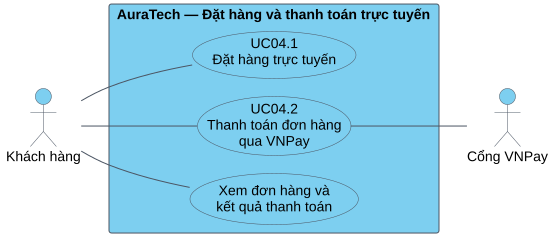

# Use Case tổng quát — Đặt hàng và thanh toán trực tuyến

Module có **hai UC chính**, mỗi UC được triển khai thành Use Case phân rã, Activity, Sequence và sơ đồ trạng thái trong [trang hình vẽ](HINH_VE.md). Bộ hình trình bày theo ảnh mẫu người dùng cung cấp; nghiệp vụ vẫn theo source AuraTech.

[PlantUML](diagrams/01-use-case.puml) · [SVG](diagrams/01-use-case.svg) · [PNG](diagrams/01-use-case.png)

## Hai UC được chọn

| Nội dung | UC04.1 — Đặt hàng trực tuyến | UC04.2 — Thanh toán đơn hàng qua VNPay |
|---|---|---|
| Mục tiêu | Ghi nhận đơn từ giỏ với giá, giao nhận và số lượng phù hợp | Hoàn tất thanh toán một đơn đã tồn tại |
| Tác nhân chính | Khách hàng | Khách hàng |
| Tác nhân hỗ trợ bên ngoài | Không có trong phạm vi hình | Cổng VNPay |
| Tiền điều kiện | Đã đăng nhập, giỏ có sản phẩm | Đơn thuộc khách, còn hạn, PENDING hoặc AWAITING_PAYMENT |
| Khởi phát | Khách xác nhận đặt hàng tại checkout | Chọn VNPay tại checkout hoặc thanh toán lại ở trang đơn |
| Kết quả thành công | Có mã đơn, chi tiết, giá chính thức; sự kiện tạo đơn trong outbox; xóa giỏ | Payment SUCCESS và sự kiện thành công trong outbox; đơn được xác nhận khi xử lý sự kiện hợp lệ |
| Ngoại lệ chính | Hết tồn, dữ liệu/ưu đãi lỗi, yêu cầu trùng, lỗi sau commit | Giao dịch lỗi/hết hạn, callback sai/trùng/muộn, retry |
| Đối tượng của state | Order | Payment |

## Lý do tách

CheckoutPage gọi tạo đơn trước, sau đó khởi tạo thanh toán. Nếu khởi tạo thanh toán lỗi, giao diện vẫn giữ mã đơn và chuyển sang trang chi tiết để thử lại. Vì vậy đặt hàng có kết quả độc lập, còn thanh toán có thể thực hiện lại trên cùng đơn.

Không dùng include giữa hai UC chính để biểu thị bước trước/sau: thanh toán lại không tạo đơn mới. Mối liên hệ được mô tả bằng tiền điều kiện/hậu điều kiện và thứ tự tương tác trong Activity/Sequence.

Trong sơ đồ phân rã, include chỉ phần hành vi bắt buộc; extend chỉ lựa chọn voucher/điểm ở preview. Các quan hệ này không chỉ thứ tự gọi API hoặc bắt buộc xử lý đồng bộ.

## Phạm vi nghiệp vụ

Khung hệ thống bao gồm phần đặt hàng và thanh toán của AuraTech. Redis, Kafka, kho và các vi dịch vụ là thành phần nội bộ, không phải tác nhân trong Use Case nghiệp vụ; chúng xuất hiện trong Sequence.

Đăng nhập là tiền điều kiện. Quản lý tài khoản, giỏ hàng, COD và vận hành giao hàng không được mở rộng thành UC chính của bộ này. Các trạng thái giao/hoàn hàng được giữ để nối vòng đời Order, ngoài phạm vi UC đặt hàng. REFUND_PENDING là điểm bàn giao ngoài phạm vi thanh toán, không phải trạng thái kết thúc.

“Xem thông tin đơn hàng và kết quả thanh toán” là chức năng hỗ trợ ở sơ đồ tổng quát, không chọn làm bộ đặc tả thứ ba.

## Phân rã hai UC

| UC | Phần chức năng |
|---|---|
| Đặt hàng | Xem trước đơn; cung cấp giao nhận; kiểm tra khả năng đáp ứng |
| Lựa chọn khi đặt hàng | Áp dụng mã giảm giá; sử dụng điểm thưởng. Preview chỉ dự tính, backend kiểm tra và áp dụng lại khi tạo đơn |
| Thanh toán | Kiểm tra điều kiện; khởi tạo lượt; xác minh và ghi nhận kết quả |
| Hỗ trợ thanh toán | Xem lại kết quả chính thức từ backend; retry là luồng thay thế trên cùng đơn |

## Dùng trong Chương 2

Bắt đầu bằng sơ đồ tổng quát và bảng hai UC. Với từng UC, dùng Use Case phân rã để xác định phạm vi, Activity để mô tả luồng, Sequence để đối chiếu cách triển khai, state để giải thích trạng thái DB và sự kiện đến muộn.

Phương pháp trình bày tham khảo hai thẻ cuối của tài liệu nhóm: **Backup** (t.przan4jkdfvu) và **Báo cáo mẫu** (t.lqjrluy5ko5n). Hành vi lấy từ code; không dùng Order PAID hoặc PAYMENT_FAILED vì source không có các trạng thái đó.
