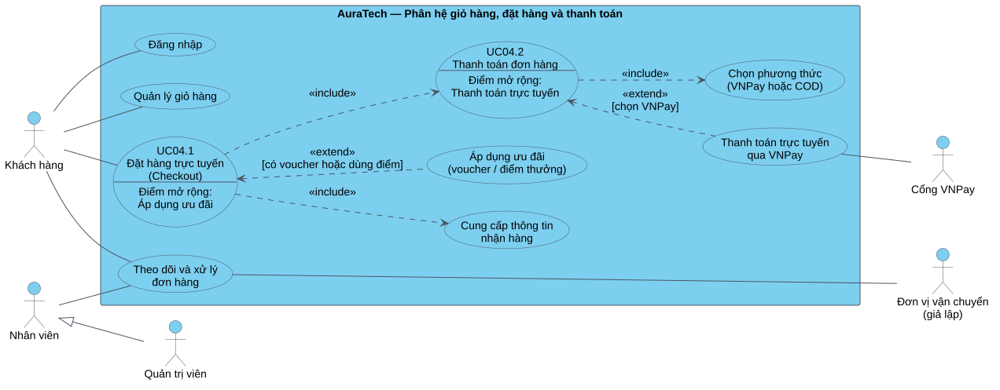

# Use Case tổng quát — Giỏ hàng, đặt hàng và thanh toán

Sơ đồ thể hiện **mục tiêu và tương tác nghiệp vụ của các tác nhân**, cập nhật ngày 15/11/2026. Giữ khung nền xanh, các điểm mở rộng theo ảnh mẫu và 5 tác nhân đã chọn.

[PlantUML](diagrams/01-use-case.puml) · [SVG](diagrams/01-use-case.svg) · [PNG](diagrams/01-use-case.png)

## Các mục tiêu chính

| Use case | Ý nghĩa với tác nhân |
|---|---|
| Quản lý giỏ hàng | Khách chuẩn bị các sản phẩm và số lượng muốn mua. |
| Đặt hàng trực tuyến (Checkout) | Khách xác nhận mua hàng, cung cấp thông tin nhận hàng và thực hiện bước thanh toán. |
| Thanh toán đơn hàng | Khách lựa chọn/xác nhận cách trả tiền bằng VNPay hoặc COD. Khách tham gia qua UC Đặt hàng; Cổng VNPay hỗ trợ thanh toán trực tuyến. |
| Theo dõi và xử lý đơn hàng | Khách theo dõi đơn; Nhân viên/Quản trị viên vận hành đơn; Đơn vị vận chuyển cung cấp trạng thái giao hàng. |

## Quan hệ nghiệp vụ

- **Đặt hàng include Thanh toán:** bước thanh toán là một phần của quy trình đặt hàng (checkout). Với COD, khách xác nhận trả tiền khi nhận hàng; với VNPay, khách thực hiện thanh toán trực tuyến.
- **Đặt hàng include Cung cấp thông tin nhận hàng:** khách cần xác định người nhận và địa chỉ giao hàng.
- **Áp dụng ưu đãi extend Đặt hàng:** hành vi tùy chọn tại điểm mở rộng Áp dụng ưu đãi, khi khách có voucher hoặc dùng điểm thưởng.
- **Thanh toán include Chọn phương thức:** khách chọn VNPay hoặc COD.
- **Thanh toán trực tuyến qua VNPay extend Thanh toán:** chỉ thực hiện tại điểm mở rộng Thanh toán trực tuyến khi khách chọn VNPay.
- **Đăng nhập** là UC riêng của khách hàng; đã đăng nhập là tiền điều kiện của các nghiệp vụ mua hàng.

Đặt hàng trong hình này được hiểu là toàn bộ checkout. Xác nhận thanh toán COD là cam kết trả tiền khi nhận hàng, chưa đồng nghĩa đã thu tiền tại thời điểm đặt đơn. Các luồng thất bại được trình bày trong đặc tả/Activity phù hợp.

## Các tác nhân

| Tác nhân | Vai trò |
|---|---|
| Khách hàng | Đăng nhập, quản lý giỏ, đặt hàng và theo dõi đơn của mình; tham gia bước thanh toán trong checkout. |
| Nhân viên | Theo dõi và xử lý các đơn hàng theo quyền vận hành. |
| Quản trị viên | Kế thừa các nghiệp vụ vận hành của Nhân viên trong phạm vi hình; mũi tên khái quát hóa hướng về Nhân viên. |
| Cổng VNPay | Hỗ trợ khách thanh toán trực tuyến. |
| Đơn vị vận chuyển (giả lập) | Cung cấp trạng thái giao hàng để theo dõi và xử lý đơn. |

Nhóm Theo dõi và xử lý đơn hàng bao quát phần việc của từng vai trò; khách chỉ theo dõi đơn của mình, còn quyền vận hành dành cho Nhân viên/Quản trị viên. Các actor phân hệ hỗ trợ được lược theo phạm vi trình bày đã chọn.

Kiểm tra giỏ, giữ tồn và xác minh webhook thuộc phần xử lý bên trong hệ thống, được trình bày ở [bộ sơ đồ chi tiết](HINH_VE.md). Hình tổng quát tập trung vào mục tiêu, lựa chọn và sự tham gia của tác nhân.
