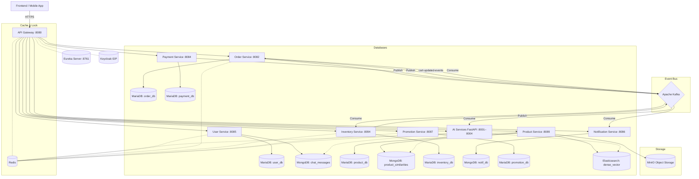

# 📚 INDEX — TÀI LIỆU THIẾT KẾ KIẾN TRÚC MICROSERVICES

> 🗄️ **Thiết kế ban đầu — một số phần KHÔNG khớp với code hiện tại (rà soát 2026-10-11).** Khác biệt chính:
> - CSDL quan hệ là **MariaDB 10.11** (host port `3308`), không phải PostgreSQL; MongoDB chỉ dùng ở notification-service (`notif_db`), chat-service (`chat_db`) và product-service (`product_similarities`).
> - Port Inventory Service là **`8094`** (gRPC `9093`), không phải `8093`; Product gRPC `9089`. Có thêm **Chat Service `:8095`** (MongoDB `chat_db`).
> - Outbox được phát lên Kafka bằng **Debezium CDC** (`MySqlConnector` + `EventRouter`), không có "Outbox Scheduler".
> - Trạng thái đơn: `PENDING → AWAITING_PAYMENT → CONFIRMED → SHIPPED → DELIVERED` / `CANCELLED` (không có `PAID`). Trạng thái payment thành công là `SUCCESS` (không có `COMPLETED`). Chỉ hỗ trợ VNPay + COD.
> - **Không tồn tại** trong code: Camunda DMN, `GetAIScoreDelegate`, `CostPriceGuard`, định giá động XGBoost trong luồng thanh toán, bảng `coupons`/`user_devices`/`chat_sessions`, Redis key `blacklist:{jti}`, `campaign:budget:{campaignId}` (ngân sách trừ trên bảng `campaigns` bằng pessimistic lock).
> - Bean Redisson có khai báo nhưng **không được dùng**; khóa phân tán dùng Redis `SET NX` thường.
> - Topic Kafka thực tế: `order-events`, `payment-events`, `inventory-events`, `cart-updated-events`, `product-viewed-events`, `product-reviewed-events`, `user-created-events`, `user-behavior-events`, `user-risk-events`, `notification-events` (chat-service publish, **chưa có consumer**). Không có `cart-events`, `user-events`.
> - Notification Service gửi email (SMTP) thật; Push FCM hiện **chỉ ghi log**; không có SMS/WebSocket.

## Hệ thống E-Commerce — Thiết kế Phân tích & Kiến trúc từng Service

> **Phiên bản:** 1.0.0 | **Cập nhật:** 2026-06-01
> **Nhóm:** Nhóm 2 — Kiến trúc & Kỹ thuật chuyên sâu

---

## 📂 Danh sách Tài liệu

| # | Service | File | Port | Database |
|---|---|---|---|---|
| 1 | **Identity & User Service** | [01_IDENTITY_USER_SERVICE.md](./01_IDENTITY_USER_SERVICE.md) | 8085 | MariaDB (ecommerce_user_db) |
| 2 | **Product & Catalog Service** | [02_PRODUCT_CATALOG_SERVICE.md](./02_PRODUCT_CATALOG_SERVICE.md) | 8089 (gRPC 9089) | MariaDB (ecommerce_product_db) + Elasticsearch + MongoDB |
| 3 | **Cart & Order Service** | [03_CART_ORDER_SERVICE.md](./03_CART_ORDER_SERVICE.md) | 8082 | MariaDB (ecommerce_order_db) + Redis |
| 4 | **Inventory Service** | [04_INVENTORY_SERVICE.md](./04_INVENTORY_SERVICE.md) | 8094 (gRPC 9093) | MariaDB (ecommerce_inventory_db) + Redis |
| 5 | **Payment Service** | [05_PAYMENT_SERVICE.md](./05_PAYMENT_SERVICE.md) | 8084 | MariaDB (ecommerce_payment_db) |
| 6 | **Notification Service** | [06_NOTIFICATION_SERVICE.md](./06_NOTIFICATION_SERVICE.md) | 8086 | MongoDB (notif_db) |
| 7 | **Promotion Service** | [07_PROMOTION_SERVICE.md](./07_PROMOTION_SERVICE.md) | 8087 | MariaDB (ecommerce_promotion_db) + Redis + Camunda |
| 8 | **API Gateway & Discovery** | [08_API_GATEWAY_DISCOVERY.md](./08_API_GATEWAY_DISCOVERY.md) | 8080 / 8761 | Redis (Rate limiting) |
| 9 | **AI Services** (4 service: search, chatbot, recs, forecast) | [09_AI_ENGINE_SERVICE.md](./09_AI_ENGINE_SERVICE.md) (thiết kế ban đầu, đã lỗi thời) · [`AI/README.md`](../../AI/README.md) | 8001–8004 | Python FastAPI + PyTorch |
| 10 | **Chat Service** | [10_CHAT_SERVICE.md](./10_CHAT_SERVICE.md) | 8095 | MongoDB (chat_db) + Redis + MinIO |

---

## 🏗️ Kiến trúc Tổng thể



---

## 🔄 Luồng Nghiệp vụ Chính

### Luồng Đặt hàng & Đánh giá phân khúc AI (Happy Path)

```
1. [User] Thêm sản phẩm vào giỏ hàng
   → Cart Service lưu vào Redis Hash "cart:{userId}"
   → Cart Service publish CartUpdatedEvent lên Kafka topic "cart-updated-events"
   → [Async] AI forecast-service consume "cart-updated-events" ghi vào bảng user_events

2. [User] Checkout đơn hàng
   → Order Service: Idempotency Check (Redis SET NX)
   → Order Service: Lua script giảm product:stock:{productId}:{variantId} (giữ chỗ kho - Redis)
   → Order Service: Lưu Order PENDING, áp voucher/điểm, rồi lưu OutboxEvent
   → Response 200 cho User ngay

3. [Async - Debezium CDC]
   → Đọc binlog bảng outbox_events → Kafka order-events: OrderCreatedEvent

4. [Async - Inventory Service]
   → Consume OrderCreatedEvent
   → Redis lock (SET NX) theo orderId + SELECT FOR UPDATE
   → Trừ kho vật lý DB
   → (inventory_daily_snapshots được chụp riêng bởi scheduler lúc 23:00 hằng ngày)
   → Kafka: InventoryDeductedEvent (CONFIRMED)

5. [Async - Order Service]
   → Consume InventoryDeductedEvent
   → UPDATE order status = AWAITING_PAYMENT

6. [Async - Notification Service]
   → Consume OrderConfirmedEvent (sau khi thanh toán/xác nhận COD)
   → Gửi email xác nhận đơn hàng (Push FCM hiện chỉ ghi log)
```

### Luồng Thanh toán & Định giá Động AI

```
7. [User] Chọn phương thức thanh toán (VNPAY)
   → (Thiết kế ban đầu, KHÔNG có trong code: Camunda DMN / GetAIScoreDelegate / XGBoost priceSensitivity / CostPriceGuard)
   → Payment Service: Tạo payment record PENDING và sinh URL VNPAY
   → Redirect User đến VNPAY

8. [VNPAY Callback - GET /api/v1/public/payments/vnpay-callback]
   → Payment Service: Verify HMAC signature & Idempotency Check
   → Payment Service: UPDATE payment SUCCESS + ghi outbox
   → Debezium → Kafka payment-events: PaymentSuccessEvent

9. [Async - Order Service]
   → Consume PaymentSuccessEvent
   → UPDATE order status = CONFIRMED

10. [Async - Notification Service]
    → Consume PaymentSuccessEvent → Gửi email xác nhận thanh toán
```

---

## 🛠️ Công nghệ Stack Toàn hệ thống

| Tầng | Công nghệ | Mục đích |
|---|---|---|
| **API Gateway** | Spring Cloud Gateway | Routing, Keycloak OAuth2 Verification, Header Injection, Redis Rate Limiting |
| **Service Discovery** | Netflix Eureka Server | Đăng ký & phát hiện dịch vụ tự động |
| **Identity Provider** | Keycloak | Quản lý định danh, sinh JWT token, phân quyền |
| **Services** | Spring Boot 3.x | Các microservices nghiệp vụ |
| **AI Backend** | FastAPI (Python) | LLM RAG, XGBoost dynamic pricing, K-Means clustering, LightGBM forecasting |
| **ORM** | Spring Data JPA + Hibernate | Tương tác MariaDB |
| **NoSQL ORM** | Spring Data MongoDB | Tương tác MongoDB |
| **Relational DB** | MariaDB 10.11 | Dữ liệu giao dịch (ACID) |
| **Document DB** | MongoDB 6.x | Chat messages, similar products, notifications, logs |
| **Cache** | Redis 7.x (Lettuce) | Cache, Blacklist, Stock, Cart, Rate limiting |
| **Distributed Lock** | Redis `SET NX` (bean Redisson có khai báo nhưng không dùng) | Khóa phân tán (checkout, consumer kho, scheduler) |
| **Message Queue** | Apache Kafka 3.x + Debezium CDC | Event-driven async communication (Outbox) |
| **Search** | Elasticsearch 8.x | Keyword search + k-NN Dense Vector search (Semantic) |
| **Object Storage** | MinIO | Lưu trữ ảnh sản phẩm |

---

## 📊 Tổng hợp Database Design

| Service | Database | Bảng/Collection chính |
|---|---|---|
| User | MariaDB: `ecommerce_user_db` | users, addresses, provinces, wards, loyalty_point_transactions |
| Product | MariaDB: `ecommerce_product_db` + MongoDB | categories, products, product_variants, product_images, product_tags (MariaDB), product_similarities (MongoDB) |
| Order | MariaDB: `ecommerce_order_db` | orders, order_items, outbox_events, compensation_tasks, user_events |
| Inventory | MariaDB: `ecommerce_inventory_db` | inventories, inventory_transactions, restock_requests, inventory_daily_snapshots |
| Payment | MariaDB: `ecommerce_payment_db` | payments, refunds, webhook_logs, outbox_events |
| Notification | MongoDB: `notif_db` | notifications, fcm_tokens, notification_templates |

---

## 🔑 Redis Key Convention

| Key Pattern | Service | Mô tả |
|---|---|---|
| `blacklist:{jti}` | User | JWT đã logout |
| `user:profile:{userId}` | User | Cache thông tin user |
| `product:{id}` | Product | Cache chi tiết sản phẩm |
| `product:similar:{id}` | Product | Cache danh sách 20 ID sản phẩm tương tự |
| `category:tree` | Product | Cache cây danh mục |
| `cart:{userId}` | Order | Giỏ hàng (Redis Hash) |
| `checkout:lock:{userId}:{key}` | Order | Idempotency key |
| `product:stock:{productId}:{variantId}` | Order/Inventory | Tồn kho giữ chỗ |
| `lock:inventory-consumer:{orderId}` | Inventory | Redis lock (`SET NX`) khi consume order-events |
| `campaign:budget:{campaignId}` | Promotion | Redis Atomic Counter ngân sách khuyến mãi |

---

## 📡 Kafka Topics & Events

| Topic | Producer | Consumer | Events |
|---|---|---|---|
| `order-events` | Order Service (Outbox + Debezium) | Inventory, Payment, Notification, Promotion, AI forecast | OrderCreated, OrderConfirmed, OrderCancelled, OrderShipped, OrderDelivered |
| `cart-updated-events` | Order Service (Cart) | AI forecast | CartUpdatedEvent |
| `inventory-events` | Inventory Service | Order Service | InventoryDeductedEvent (`status` CONFIRMED / FAILED) |
| `payment-events` | Payment Service (Outbox + Debezium) | Order, Notification, Promotion | PaymentSuccess, PaymentFailed, PaymentCODConfirmed, RefundCompleted |
| `user-created-events` | User Service | Promotion | UserRegisteredEvent |
| `product-viewed-events` | Product Service | AI forecast | ProductViewedEvent |
| `product-reviewed-events` | Product Service | Promotion | ProductReviewedEvent |
| `user-behavior-events` | AI forecast (nhận từ FE) | AI forecast | Vi hành vi |
| `user-risk-events` | AI forecast | Promotion | ChurnRiskDetectedEvent |
| `notification-events` | Chat Service | **(chưa có consumer)** | SupportChatOfflineEvent |

---

## ✅ Checklist Thiết kế (Design Review)

### Resilience (Khả năng chịu lỗi)
- [x] Outbox Pattern — đảm bảo event không bị mất khi Kafka gặp sự cố
- [x] Idempotent Consumer — chống xử lý event trùng lặp
- [x] Retry Mechanism — tự động thử lại khi gửi notification thất bại
- [x] Circuit Breaker — ngăn cascading failure khi email provider chết

### Performance (Hiệu năng)
- [x] Redis Cache — giảm 95% query xuống DB cho đọc sản phẩm & sản phẩm tương đồng
- [x] Redis DECRBY — lọc sớm 99.9% request hết hàng tại RAM
- [x] Async Event-Driven — không block response của user
- [x] Elasticsearch (BM25) + FAISS (vector, AI search-service) — tìm kiếm ngữ nghĩa thời gian thực không block MariaDB

### Security (Bảo mật)
- [x] API Gateway centralized auth — Verify JWT tại Gateway, inject X-User-Id header
- [x] Keycloak OAuth2 IDP — Quản lý tập trung tài khoản, session và phân quyền
- [x] Webhook Signature Verify — chống giả mạo callback từ cổng thanh toán
- [x] Redis Rate Limiter — chống brute-force và spam API AI

### Consistency (Nhất quán dữ liệu)
- [x] Redis Distributed Lock (`SET NX`) — chống xử lý trùng khi trừ kho
- [x] Pessimistic Lock (SELECT FOR UPDATE) — bảo vệ DB vật lý
- [x] Self-Healing Redis Sync — tự phục hồi khi Redis bị lệch với DB
- [x] Logical FK (No Physical FK) — giữ độc lập giữa các DB của service

---
*Tài liệu này là bản tổng hợp — Tham chiếu từng file cụ thể để xem chi tiết.*
